<p align="center">
  <picture>
    <source media="(prefers-color-scheme: dark)" srcset="docs/logo/omnideck-logo-dark.png">
    
  </picture>
</p>

One telemetry display for ArduPilot, INAV and Betaflight, on FrSky Ethos and EdgeTX colour radios, with OpenTX 2.3 (in progress).

A full-screen widget with a horizon and tapes, a moving map with optional satellite tiles, status messages, voice call-outs and a flight summary, the same on every flight controller and every radio link.

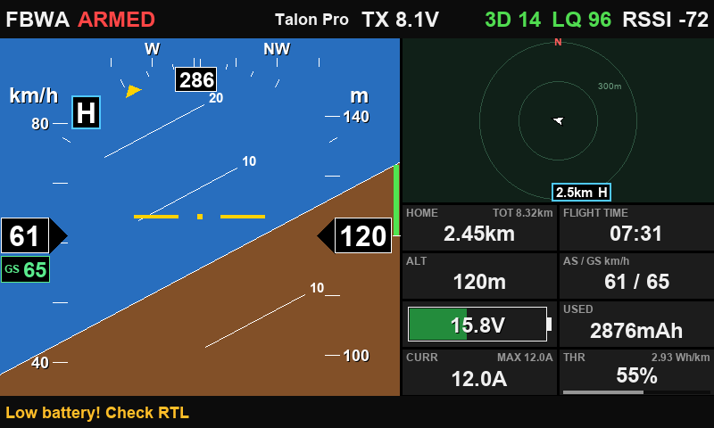

**Status:** 0.3b, public beta. The same guide with a side outline is at [erwinquilloy.github.io/ardupilot-tools/omnideck.html](https://erwinquilloy.github.io/ardupilot-tools/omnideck.html).

## Contents

- [What it does](#what-it-does)
- [Radios and links](#radios-and-links)
- [Install](#install)
- [Flight controller setup](#flight-controller-setup)
- [Main page and HUD](#main-page-and-hud)
- [Changing pages](#changing-pages)
- [Map](#map)
- [Messages](#messages)
- [Flight summary and stats](#flight-summary-and-stats)
- [Sensor check](#sensor-check)
- [On EdgeTX](#on-edgetx)
- [Settings](#settings)
- [Map tiles](#map-tiles)
- [Missions](#missions)
- [Voice and alarms](#voice-and-alarms)
- [Reporting a problem](#reporting-a-problem)
- [Development](#development)
- [Credits](#credits)

## What it does

- **Avionics:** artificial horizon with pitch ladder and roll scale, speed and altitude tapes, heading tape with a home marker, vertical speed bar.
- **Map:** vector map with range rings, flight trail, home and waypoints, or satellite and street tiles from the SD card. Aircraft-centred or home-centred, north up or heading up.
- **Data blocks:** distance to home and total distance, flight time, altitude, airspeed and ground speed, battery gauge, mAh used, current, throttle and live efficiency.
- **Status messages** from ArduPilot with severity colours and a beep. A repeated message shows once with a count.
- **Ready to arm** while disarmed, and voice call-outs for flight modes, arming, battery, failsafes and GPS.
- **Flight summary** on disarm, an optional live **Flight stats** page, and a **flight log** file per flight on the SD card.
- **Missions:** ArduPilot `.waypoints` files (Ethos) or waypoints learned from telemetry; INAV missions downloaded over the telemetry link.

## Radios and links

| Radio | System | Screen | Status |
|---|---|---|---|
| FrSky X20S (X20 family) | Ethos | 800 x 480 | Tested |
| FrSky X18 | Ethos | 480 x 320 | Tested |
| FrSky X14 | Ethos | 640 x 360 | Simulator only |
| RadioMaster TX16S MK2 | EdgeTX | 480 x 272 | Tested |
| RadioMaster TX16S MK3 / MK3 Max | EdgeTX | 800 x 480 | Tested |
| OpenTX colour radios | OpenTX 2.3 | 480 x 272 | (in progress) |

ArduPilot sends FrSky passthrough telemetry (the same data Yaapu uses) over every link. INAV and Betaflight are read from the radio's own telemetry sensors.

| Link | Radio | ArduPilot | INAV | Betaflight |
|---|---|---|---|---|
| TBS Crossfire (CRSF) | Ethos, EdgeTX | Tested | Tested | Tested |
| ExpressLRS (CRSF) | Ethos, EdgeTX | Tested | Tested | Tested |
| mLRS (CRSF passthrough) | Ethos, EdgeTX | Tested | Tested | Not tested |
| FrSky F.Port (R9, Archer 2.4) | Ethos | Tested | Tested | Not tested |
| FrSky S.Port | Ethos | Not tested | Not tested | Not tested |

"Not tested" means the combination has not been checked on a radio yet, not that it is known not to work.

- **ArduPilot** (Plane, including QuadPlane; Copter mode names included): attitude, GPS, home, battery and capacity, flight mode, armed and flying flags, failsafes, waypoint, wind and status messages. Flight time counts only while ArduPilot reports it is flying.
- **INAV** (tested with 7 and 9): attitude, GPS, altitude, speeds, battery, flight mode and ready to arm. Airspeed only with a pitot, real or virtual. No status messages. Flight time counts from arming.
- **Betaflight:** attitude, GPS, speed, battery, flight mode, and ready to arm from the CRSF flight mode text. No airspeed and no status messages.
- **Throttle:** ArduPilot sends its real throttle output. INAV and Betaflight send none, so THR shows your radio's throttle stick (0 to 100 %), which can differ from the motor in INAV's automatic modes.

## Install

Download the package for your radio from the [releases page](https://github.com/erwinquilloy/OmniDeck/releases) and unzip it on the PC. Each package holds an `INSTALL.txt` with the same steps.

| Package | For |
|---|---|
| `OmniDeck_Ethos_0.3b.zip` | Any Ethos colour radio. Holds both screen sizes; the radio picks the right one. |
| `OmniDeck_Ethos_0.3b_X20.zip` | X20 family only (800 x 480). Smaller download. |
| `OmniDeck_Ethos_0.3b_X18.zip` | X18 and other 480 x 320 Ethos screens only. |
| `OmniDeck_EdgeTX_0.3b.zip` | EdgeTX colour radios: TX16S MK2 (480 x 272), MK3 and MK3 Max (800 x 480). |

### Ethos

1. Connect the radio by USB and choose the SD card, or use a card reader.
2. Copy the `scripts` folder from the package to the **root** of the card. You should end up with:

   ```
   scripts/omnideck/
   ├── main.lua      loader: picks x18/ or x20/ by screen width
   ├── x20/          the code for 800 x 480 screens
   ├── x18/          the code for 480 x 320 and smaller
   ├── audio/        voice packs: Aria, Guy, Christopher, Michelle
   ├── tones/        message beeps
   ├── logos/        panel logos; add your own PNG here
   ├── missions/     ArduPilot .waypoints files
   └── logs/         one text file per flight
   ```
3. Eject the card and restart the radio.
4. Add **OmniDeck** to a screen with a **full-screen** layout. In a smaller slot it shows only the minimap.
5. Long-press the widget and choose **Configure widget** for the [settings](#settings).

**Updating:** copy the new `scripts` folder over the old one, then delete any `.luac` files in `scripts/omnideck/` and its `x18/`, `x20/` folders so the radio compiles the new code. Coming from test 41 or older: delete the old loose `.lua` files in `scripts/omnideck/` (audio, hud, map, mission, mspclient, summary, telem, tiles, ui) but keep the new `main.lua` and the folders. `lastpos.txt` is no longer used.

### EdgeTX

1. Connect the radio by USB and pick **USB Storage (SD)**, or use a card reader.
2. Copy the `WIDGETS` and `SCRIPTS` folders to the **root** of the card:

   ```
   WIDGETS/OmniDeck/
   ├── main.lua  etx.lua  ui.lua  hud.lua  map.lua ...
   ├── audio/        voice packs: Aria, Guy
   ├── fixed/        pre-drawn panel and HUD frames
   ├── tones/  logos/  missions/
   └── logs/         one text file per flight
   SCRIPTS/TOOLS/
   ├── OmniDeck Setup.lua    the settings, per model
   └── OmniDeck Check.lua    load test that shows any error
   ```
3. Eject the card and restart the radio.
4. Add a screen with a **one-zone layout** (no top bar, no sliders, no trims) and pick OmniDeck for the zone.
5. Long-press the widget and choose **Full screen** to change pages and zoom. EdgeTX passes touch and keys to a widget only in full screen. Long-press RTN to leave.
6. Settings: **SYS › Tools › OmniDeck Setup**.

**Updating:** delete the `.luac` files in `WIDGETS/OmniDeck/` first, then copy the new folders.

**Not in the widget list?** Run **SYS › Tools › OmniDeck Check**: it loads the widget the way EdgeTX does and shows the exact error.

## Flight controller setup

| Flight controller | Link | Setting |
|---|---|---|
| ArduPilot | CRSF (ELRS, Crossfire) | `RC_OPTIONS` bit 8, CRSF passthrough. With ELRS keep packet rate × telemetry ratio above about 30 telemetry frames a second. |
| ArduPilot | S.Port | `SERIALn_PROTOCOL 10` |
| ArduPilot | F.Port (R9, Archer 2.4) | `SERIALn_PROTOCOL 23` |
| ArduPilot | mLRS | Set the Tx module to send CRSF passthrough to the radio. |
| INAV, Betaflight | CRSF | Normal CRSF telemetry. |
| INAV | S.Port, F.Port | Serial RX, provider `FPORT` (F.Port), half-duplex ON, signal on the UART's TX pad. Turn on **Use Pitch & Roll sensors in telemetry** for the horizon. |

- **INAV and Betaflight:** power the aircraft and run **Model › Telemetry › Discover new sensors** on the radio before using OmniDeck. After changing links, delete the old sensors and discover again.
- **ArduPilot ground speed next to airspeed** needs `FRSKY_OPTIONS` bit 0; otherwise only one of the two is sent.
- **Battery capacity:** ArduPilot sends `BATT_CAPACITY`. For INAV and Betaflight enter the pack size under **Battery mAh (INAV/BF only)**. The battery bar also needs a working current sensor.
- **INAV virtual pitot** sends an estimate as if it were airspeed. Set the pitot to NONE if you would rather see ground speed on the tape.

## Main page and HUD

Yellow pins mark the top bar and the HUD, blue pins the top-right panel and the data blocks.

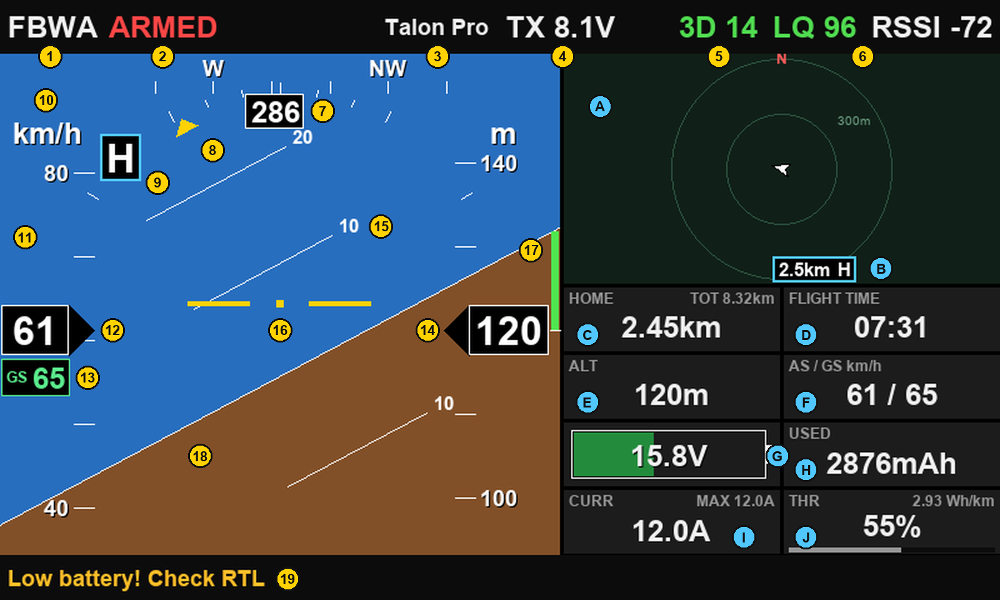

**Top bar**

| | |
|---|---|
| 1 | **Flight mode** as the flight controller names it (FBWA, AUTO, RTL, ANGL, ACRO, AIR...). Spoken on each change. |
| 2 | **Arm state:** ARMED in red, DISARMED in grey. **NO TELEMETRY** replaces both when the link drops. |
| 3 | **Model name** from the radio. |
| 4 | **Radio battery** (TX voltage). |
| 5 | **GPS fix and satellites**, e.g. 3D 14. Green with a 3D fix. |
| 6 | **Link quality and RSSI** from the receiver. |

**HUD**

| | |
|---|---|
| 7 | **Heading box and compass strip:** heading in degrees, with N, NE, E... on the strip above it. |
| 8 | **Roll scale and pointer:** ticks around the top of the horizon; the yellow pointer shows the bank angle. |
| 9 | **Home marker H:** where home is relative to the nose. The strip's full width is ±90°; past that the H parks at the end on home's side (turn that way), and it hides only when home is within 5° of the tail. |
| 10 | **Speed unit** for the speed tape (km/h, m/s, kn or mph). The altitude tape on the right has its own (m or ft). |
| 11 | **Speed tape:** airspeed when the aircraft sends it. With no airspeed (no pitot, Betaflight) it shows ground speed. |
| 12 | **Speed value box:** black for airspeed, green when the tape is showing ground speed. |
| 13 | **GS box:** ground speed under the airspeed box, when both are available. |
| 14 | **Altitude tape and value box:** altitude above home. |
| 15 | **Pitch ladder:** a line every 10°, short marks at 5°. |
| 16 | **Aircraft symbol:** the yellow wings and dot; the horizon moves around it. |
| 17 | **Vertical speed bar** on the HUD's right edge: green climbing, orange sinking, full at ±5 m/s. |
| 18 | **Sky and ground.** While disarmed the arming state shows here, under the aircraft symbol. |
| 19 | **Latest status message** in the bottom bar, coloured by severity. |

**Top-right panel and data blocks**

| | |
|---|---|
| A | **Top-right panel**, by default the minimap: range rings, aircraft, home and (on Ethos) trail and mission. |
| B | **Home badge:** the H in a blue-framed box. When home is off the minimap it sits on the edge with the distance to home. |
| C | **HOME:** distance to home. The small TOT note is the total distance flown. |
| D | **FLIGHT TIME:** white while the clock runs. After a disarm the last flight's time stays, dimmed, until the next arming. |
| E | **ALT:** altitude now. |
| F | **AS / GS:** airspeed and ground speed now. GS alone when there is no airspeed. |
| G | **Battery:** capacity left as a bar, voltage on top. Green, amber below 30 %, red below 15 % or on a battery failsafe. |
| H | **USED:** mAh drawn from the pack. |
| I | **CURR:** current now, with the flight's maximum. |
| J | **THR:** throttle with a bar, and the live efficiency in the corner. |

### Top-right panel choices

Setting **Main page top-right panel** (Ethos) or **Top-right panel** (EdgeTX Setup):

| Choice | What it shows |
|---|---|
| Minimap | The default. Range rings, aircraft, home badge; trail and mission on Ethos. |
| Home arrow | The OmniDeck logo before arming, then a large arrow pointing home. Up means home is straight ahead. |
| Radar | Home and aircraft on a radar disc, in the style of iNav LuaTelemetry. |
| OmniDeck logo | The logo only. |
| Logo file (Ethos) · Stratos logo (EdgeTX) | On Ethos, any PNG in `scripts/omnideck/logos/`, picked under **Logo file**. |

| | |
|---|---|
| 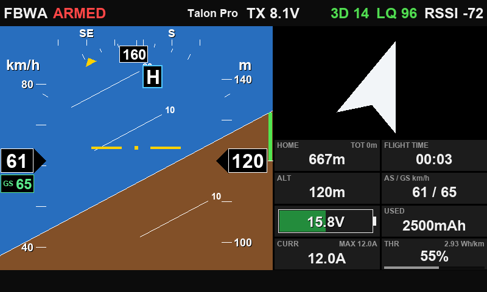 | 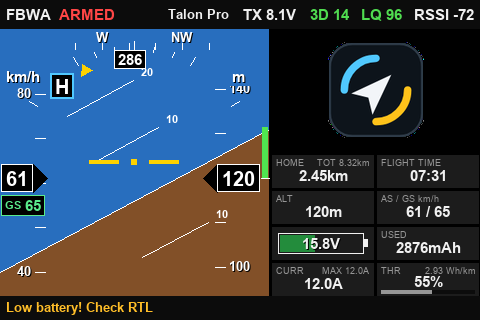 |
| Home arrow panel: home is about 20° to the right. | X18 (480 x 320) with the OmniDeck logo panel. |

### Arming states

| | |
|---|---|
| 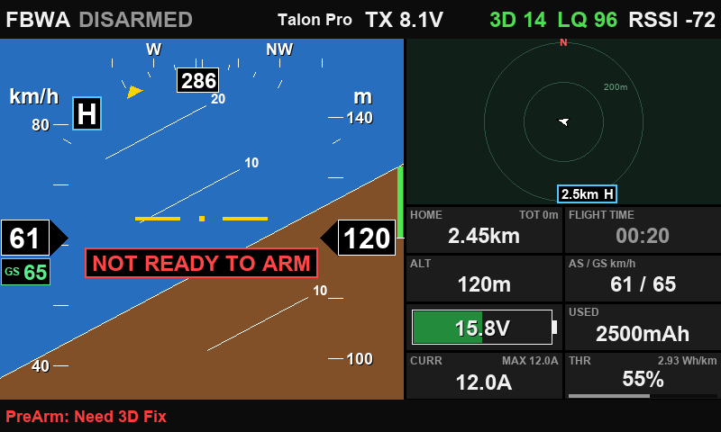 | 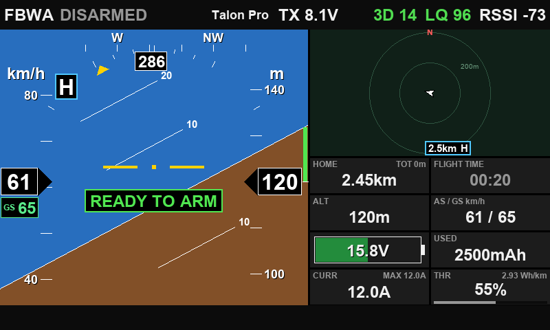 |
| NOT READY TO ARM, with the PreArm reason in the bottom bar. | READY TO ARM. The dimmed 00:20 is the last flight's time. |

INAV and Betaflight report ready-to-arm themselves. ArduPilot sends no such flag, so OmniDeck works it out: NOT READY holds for 40 s after a PreArm or critical message, and while a fitted GPS has no 3D fix, the EKF reports a problem or a failsafe is active. READY needs 40 s disarmed with none of these. Until then it shows CHECKING ARMING. The flight controller still has the last word.

### INAV and Betaflight

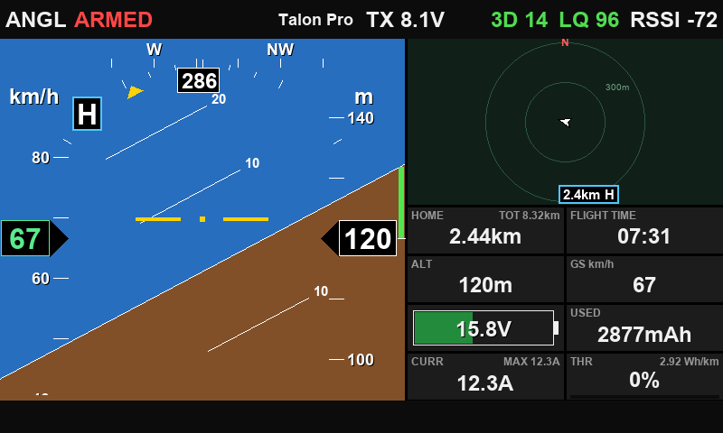

INAV in ANGL mode with no pitot: the speed box is green because the tape shows ground speed, and the AS / GS block shows GS alone. THR is the radio's throttle stick.

## Changing pages

Tap the screen or press ENTER for the next page. The wheel zooms the map and scrolls the messages. On EdgeTX this works in full screen; a **Page switch** in OmniDeck Setup changes pages outside full screen too.

| Page | In the cycle |
|---|---|
| Main | Always. |
| Map | Always. |
| Messages | Setting **Messages page**: Auto (ArduPilot only, the default), On or Off. |
| Flight stats | Setting **Flight stats page**, Off by default. On: always in the cycle, live during the flight. |
| Sensor check | Setting **Sensor check page**, Off by default. Turn it on when you report a problem. |

The **flight summary** opens by itself on disarm (if **Flight summary on disarm** is On and the aircraft was armed for at least 10 s) and goes back to the main page after 15 s. Tap or turn to another page to leave sooner.

## Map

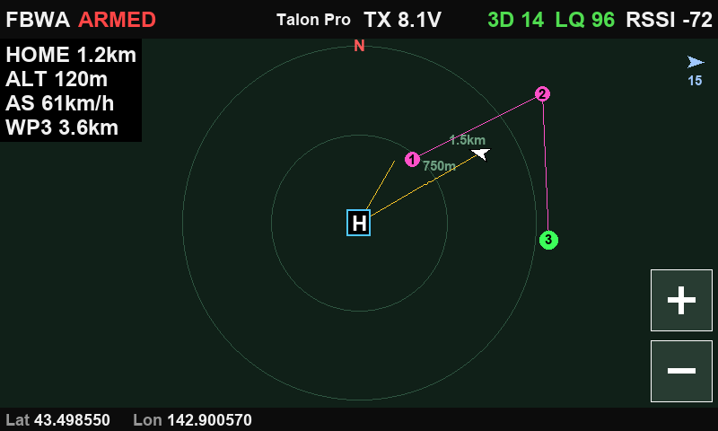

- **Info box** (top left): distance to home, altitude, airspeed, the active waypoint and its distance, and the tile set with its zoom when tiles are on.
- **Wind** (top right): the blue arrow and its speed.
- **Range rings** with their distances. The map zooms itself; + and − or the wheel zoom by hand.
- **Trail** in yellow. The **H** badge marks home; off the map it waits on the edge with the distance.
- **Bottom bar:** the aircraft's latitude and longitude.
- **Map view** and **Map orientation** settings: aircraft-centred or home-centred, north up or heading up. A tiled map is always north up.

| | |
|---|---|
| 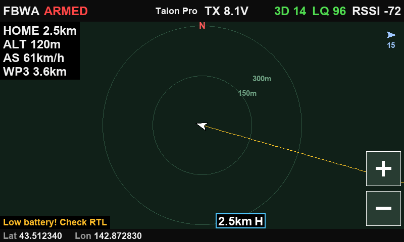 | 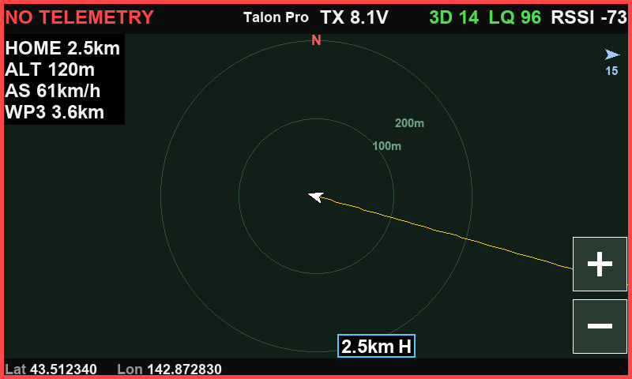 |
| Aircraft-centred, north up, home off to the south. | Telemetry lost: red frame, NO TELEMETRY, last position kept. |

## Messages

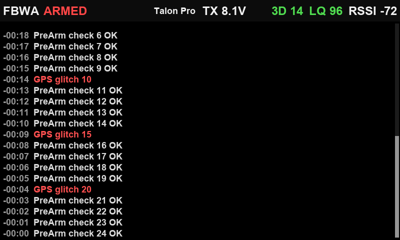

- ArduPilot status messages, newest at the bottom, each with how long ago it arrived. Errors in red, warnings in amber.
- The same message repeated shows once, with a count.
- The wheel scrolls back; the bar on the right shows where you are.
- **Message beep:** one blip for info, a double beep for a warning, a two-tone alarm for an error. A burst gives one beep.

## Flight summary and stats

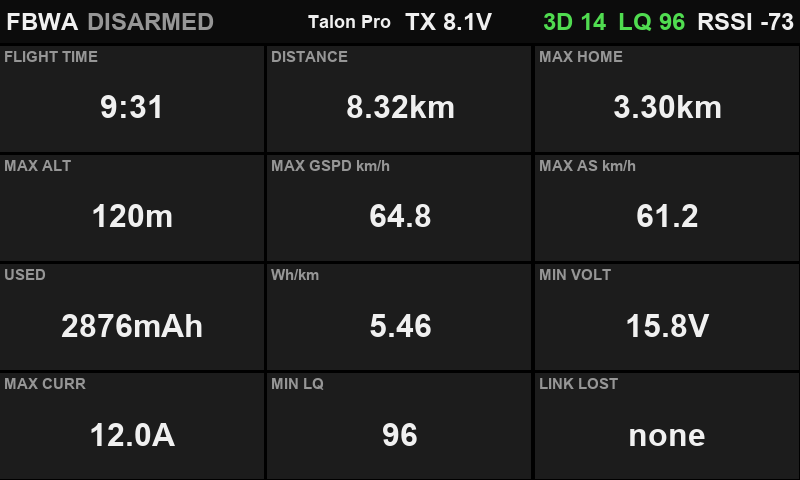

Flight time, distance flown, furthest from home, maximum altitude, ground speed and airspeed, mAh used, efficiency, lowest voltage, maximum current, lowest link quality, and link losses. With **Flight stats page** On the same page is in the cycle during the flight (FLIGHT TIME (NOW), figures so far), and says "No flight yet" before the first one.

**Flight logs:** each flight that opens a summary is saved as its own text file, `<model>-<YYYY-MM-DD>-<HHMMSS>.txt`, with the date and time, model, flight controller and link, the summary's figures, home, the last position and the last 10 messages. Ethos: `scripts/omnideck/logs/`. EdgeTX: `WIDGETS/OmniDeck/logs/`.

## Sensor check

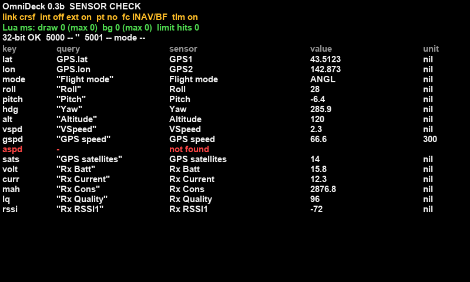

Each value, the radio sensor it comes from, and its reading. "not found" in red means the radio has no such sensor (here INAV with no pitot, so no airspeed). The header shows the version, the link, whether passthrough is arriving, the flight controller type and the Lua time per update. Turn it on with **Sensor check page** and send a photo of it with any report.

## On EdgeTX

| | | |
|---|---|---|
| 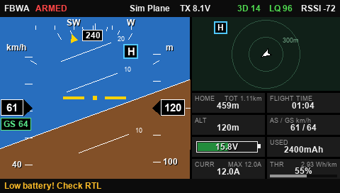 | 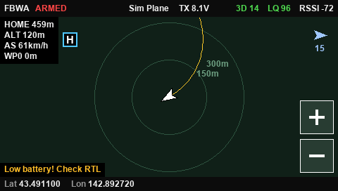 | 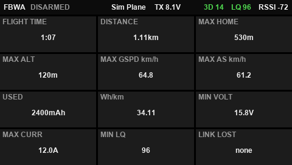 |

The same pages, drawn a little lighter: the main-page minimap has no trail or mission (the Map page has both), the tapes label every other step and the pitch ladder is labelled on one side.

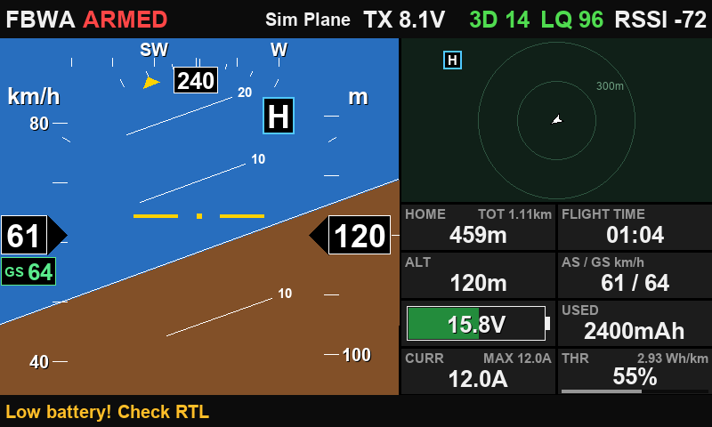

### EdgeTX versions and the CPU limit

EdgeTX stops a widget whose screen update runs more than about 20,000 Lua instructions (the "CPU limit" message). It counts instructions, not time, so a faster radio gets no extra room. Ethos has no such limit. OmniDeck lets EdgeTX draw the horizon ground and clipped lines in C where the version allows it.

| EdgeTX | Horizon ground in C | Clipped lines in C | Heaviest main-page update |
|---|---|---|---|
| 2.11, 2.12 | Yes | All | 70 % of the limit |
| 2.9, 2.10 | Yes | Only lines with no part left of or above the screen | 72 % of the limit |

0.3b, worst case in the EdgeTX simulator (`tools/sim_edgetx.py`, run as EdgeTX 2.12.0 and 2.9.4): ArduPilot over CRSF with a 120-waypoint mission. S.Port peaks at 68 %, INAV and Betaflight at 62 %, and a typical main-page update in steady flight is about 48 %. The 800 x 480 screen costs the same as 480 x 272.

**Recommendation:** use EdgeTX 2.11 or later, ideally the latest 2.12.x. Keep the radio's own telemetry alarms and the flight controller's failsafes as your safety net; OmniDeck is a display. Since 2.11.1, EdgeTX refuses sound files whose path is longer than 45 characters: the bundled packs fit, and your own pack's folder name should be 4 letters or fewer.

## Settings

On Ethos: long-press the widget › **Configure widget**. On EdgeTX: **SYS › Tools › OmniDeck Setup**, saved per model to `WIDGETS/OmniDeck/<model name>.cfg`; the widget itself has one option, **Page**, to fix a page per screen.

| | | |
|---|---|---|
| 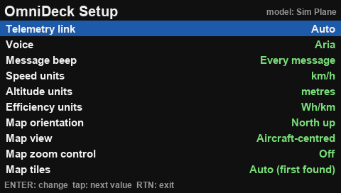 | 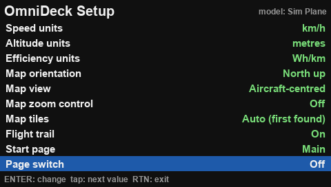 | 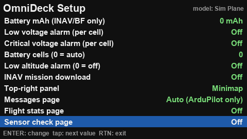 |

| Setting | Choices | Notes |
|---|---|---|
| Telemetry link | Auto · CRSF / ELRS / mLRS · S.Port / F.Port / FBUS | Auto picks the link whose sensors are receiving. |
| Voice | Off · voice packs on the card | Picking one plays a test clip. |
| Message beep | Every message · Warnings and errors · Off | Works with the voice off. |
| Speed units | km/h · m/s · knots · mph | |
| Altitude units | metres · feet | |
| Efficiency units | Wh/km · mAh/km · Wh/mi · mAh/mi | Shown in the THR block and the summary. |
| Map orientation | North up · Heading up | A tiled map is always north up. |
| Map view | Aircraft centred · Home centred | Home centred zooms out to keep the aircraft on the map. |
| Zoom source (Ethos) · Map zoom control (EdgeTX) | A pot, slider or switch | Optional manual zoom. |
| Map tiles | Off · the tile sets found on the card | EdgeTX also has Auto, the first set found. |
| Mission file (Ethos) | None · `.waypoints` files | ArduPilot; without a file, waypoints are learned from telemetry. |
| INAV mission download | Off · On | Off by default. Ethos also has a Reload button. |
| Flight trail | On · Off | Ethos has a button to clear the trail and learned waypoints. |
| Battery mAh (INAV/BF only) | 0 to 50,000 (EdgeTX 30,000) | ArduPilot sends its own capacity. |
| Low / Critical voltage alarm | Volts per cell, 0 = off | "Low voltage" every 30 s, "Critical voltage" every 15 s, after 5 s below. |
| Battery cells | 0 = auto, up to 14 | Set it for Li-ion or a part-charged pack. |
| Low altitude alarm | 0 = off, up to 3,000 | "Terrain, pull up" when armed and below it, after having been above it once. |
| Flight summary on disarm | On · Off | |
| Start page | Main · Map | |
| Top-right panel | Minimap · Home arrow · Radar · OmniDeck logo · Logo file / Stratos logo | See [Top-right panel choices](#top-right-panel-choices). |
| Logo file (Ethos) | None · PNGs in `logos/` | For the Logo file panel. |
| Messages page | Auto (ArduPilot only) · On · Off | |
| Flight stats page | Off · On | On: in the cycle, live in flight. |
| Sensor check page | Off · On | |
| Page switch, Page switch action (EdgeTX) | A switch · next page or position picks the page | Changes page outside full screen too. |

## Map tiles

Without tiles you get a vector map with range rings. For satellite or street maps, OmniDeck reads the tile folders used by the [ETHOS Mapping Widget](https://github.com/b14ckyy/ETHOSMappingWidget-Revisited), so tiles made for it, and Yaapu's Google tiles, work as they are. You don't need the Mapping Widget itself.

1. On a PC open the [High Resolution Map Generator](https://martinovem.github.io/High-Resolution-Map-Generator/) in Chrome or Edge.
2. Set **Output Target** to **b14ckyy ETHOS Mapping Widget**.
3. Pick the provider and map type, for example Google Satellite, and a zoom range such as 12 to 17. Draw a box larger than the area you fly in.
4. Save or extract the result. It is a `maps` folder with provider, type and zoom folders inside.
5. Copy that `maps` folder to the path for your radio below. Capitals matter: `GOOGLE/Satellite`, not `google/satellite`.
6. Restart the radio and pick the set under **Map tiles**. Only sets found on the card are listed, with their zoom range.

### Ethos

```
bitmaps/ethosmaps/maps/            <- the generator's "maps" folder goes here
├── GOOGLE/
│   └── Satellite/
│       ├── 12/ ... 17/            one folder per zoom level
│       │   └── 117554/            tile column (x)
│       │       └── 47906.jpg      tile row (y)
├── ESRI/   OSM/   MAPTILER/
bitmaps/yaapu/maps/                Yaapu Google tiles, as they are
```

One tile: `/bitmaps/ethosmaps/maps/GOOGLE/Satellite/15/27470/15200.jpg`. The `bitmaps` folder sits at the card root next to `scripts`; create it if the card has none.

### EdgeTX

```
IMAGES/ethosmaps/maps/             <- IMAGES, not bitmaps
├── GOOGLE/Satellite/15/27470/15200.jpg
├── ESRI/   OSM/   MAPTILER/
IMAGES/yaapu/maps/                 Yaapu Google tiles
```

One tile: `/IMAGES/ethosmaps/maps/GOOGLE/Satellite/15/27470/15200.jpg`. In OmniDeck Setup › **Map tiles**: Auto (first set found), Off, or a set by name.

- JPG tiles load fastest; PNG works too.
- Ethos queues a whole screen of tiles in a few updates, nearest the aircraft first. EdgeTX loads two per update.

## Missions

- **INAV:** with **INAV mission download** turned on (it is off by default), OmniDeck downloads the mission from the flight controller over the telemetry link (CRSF/ELRS or S.Port), a few seconds after the link comes up.
  - Waypoints show numbered, holds as H and landings as L; the active waypoint is green.
  - A mission uploaded after the radio started shows within about 10 s while the aircraft is disarmed.
  - Only the first mission on the flight controller is shown. **Save it to EEPROM** in INAV Configurator, or the flight controller won't have it after a power cycle.
- **ArduPilot:** ArduPilot's radio telemetry has no mission download.
  - **Ethos:** copy a Mission Planner / QGC `.waypoints` file to `scripts/omnideck/missions/` and pick it under **Mission file**; the whole route draws, with the active waypoint in green.
  - **Without a file, and on EdgeTX:** each waypoint is placed on the map when it becomes active, from ArduPilot's distance and bearing to it, so the route builds up as you fly.
- **Betaflight:** no missions.

## Voice and alarms

- **Call-outs:** flight modes, arm and disarm, battery percent (50, 40, 30, 25, 20, 15, 10 and 5 % while armed), failsafes, GPS fix changes, telemetry lost and recovered, ready and not ready to arm, and status messages worth hearing, such as "Takeoff complete".
- **Voice packs:** Ethos ships Aria, Guy, Christopher and Michelle in `scripts/omnideck/audio/`; EdgeTX ships Aria and Guy in `WIDGETS/OmniDeck/audio/`. A copy of Yaapu's English sound folder there also works, because the file names match.
- **Alarms:** low and critical voltage per cell, and the low-altitude "Terrain, pull up". See [Settings](#settings).

## Reporting a problem

Please send the radio model and its Ethos or EdgeTX version, the flight controller and its version, the link, and a photo of the **Sensor check** page. For a script error, send the exact text.

- **No telemetry on INAV or Betaflight:** discover the sensors again on the radio with the aircraft powered.
- **Horizon level on INAV over S.Port or F.Port:** turn on **Use Pitch & Roll sensors in telemetry** in INAV.
- **Flight time 00:00 on ArduPilot on the bench:** expected. It only counts while ArduPilot reports it is flying.
- **No flight summary:** the aircraft has to be armed for at least 10 s.
- **Tiles not listed:** check the folder path and capitals, then restart the radio.
- **EdgeTX "CPU limit" or widget missing:** run OmniDeck Check; update to EdgeTX 2.11 or later.

## Development

The shared code in `scripts/omnideck/` runs on Ethos as it is. On EdgeTX, `edgetx/WIDGETS/OmniDeck/etx.lua` provides the Ethos-style calls over EdgeTX's, and all shared modules stay valid Lua 5.2.

- **Ethos simulator:** `python tools/sim.py [outdir] [--sport] [--native] [--tiles] [--res 800x480|480x320|480x272]` runs the widget in Lua 5.4 (lupa) against a stubbed Ethos API, feeds a simulated flight encoded as `AP_Frsky_SPort_Passthrough.cpp` does (or native sensors with `--native`), checks the decoded values and renders every page to PNG.
- **EdgeTX simulator:** `python tools/sim_edgetx.py [outdir] [--sport] [--native]` runs it in Lua 5.2 with EdgeTX's instruction limit (about 20,000 Lua instructions per widget call) and checks decoding, pages, touch, sound, link loss, the Setup tool and a 120-waypoint mission. The heaviest page must stay within 88 % of the limit.
- **EdgeTX build:** `python tools/build_edgetx.py <SD root> [--audio <voice folders>]` writes `WIDGETS/OmniDeck/` and the tools.
- **Voice packs:** `python tools/voicepack.py <folder> Aria Christopher Michelle` builds packs from `tools/phrases.psv`.

## Credits

OmniDeck is written by Erwin Quilloy. It builds on what these projects worked out first; their code was read as reference.

- **[Yaapu FrSky Telemetry Script](https://github.com/yaapu/FrskyTelemetryScript)** by Alessandro Apostoli (yaapu): ArduPilot passthrough decoding, status-text and sound handling, and the flight timer that follows ArduPilot's flying flag. Its sound file names let Yaapu voice folders work as OmniDeck packs.
- **[ETHOS Mapping Widget Revisited](https://github.com/b14ckyy/ETHOSMappingWidget-Revisited)** by Marc Hoffmann (b14ckyy): the tile folder layout OmniDeck reads, and Ethos file and settings-storage behaviour. Originally by yaapu.
- **[High Resolution Map Generator](https://github.com/MartinovEm/High-Resolution-Map-Generator)** by Emiliyan Martinov (MartinovEm): the web tool that makes the map tiles.
- **[INAV Telemetry Dashboard for Ethos](https://github.com/iNavFlight/ETHOS-Telemetry-Dashboard)** by Rob Thomson (iNavFlight): INAV and Betaflight sensor names over CRSF and S.Port, flight-mode and arming decoding, and creating the sensors Ethos doesn't discover on R9.
- **[iNav OpenTX Telemetry Widget](https://github.com/iNavFlight/OpenTX-Telemetry-Widget)** (iNavFlight): how INAV flight time is counted, from arming.
- **dashx Project:** reading Ethos's own telemetry-lost flag, so a lost link shows at once.
- **[LeoBar (leobarua)](https://github.com/leobarua):** hardware for development and testing.
- **Testers, [Marcin J (jaroszmm)](https://github.com/jaroszmm), [Carticiak](https://github.com/Carticiak), Pete Davey and [Leslie Yagin (molokaiboy)](https://github.com/molokaiboy):** testing the pre-release builds and their valuable feedback.
- **Voices:** Aria, Christopher and Michelle are generated with Microsoft Edge text-to-speech voices.

## Licence

OmniDeck is free software under the [GNU General Public License v3.0](LICENSE).

## Support

OmniDeck is free. If it helps you fly, a coffee keeps it going: PayPal [$10](https://paypal.me/iamwinq/10USD) · [any amount](https://paypal.me/iamwinq), or [Ko-fi](https://ko-fi.com/windfpv).
