<p align="center">
  <picture>
    <source media="(prefers-color-scheme: dark)" srcset="docs/logo/omnideck-logo-dark.png">
    
  </picture>
</p>

A free telemetry script for ArduPilot, INAV and Betaflight, on FrSky Ethos and EdgeTX colour radios, EdgeTX black-and-white radios ([OmniDeck Mono](#omnideck-mono-black-and-white-radios), beta), with OpenTX 2.3 (in progress).

A full-screen widget with a horizon and tapes, a moving map with optional satellite tiles, status messages, voice call-outs and a flight summary, the same on every flight controller and every radio link.

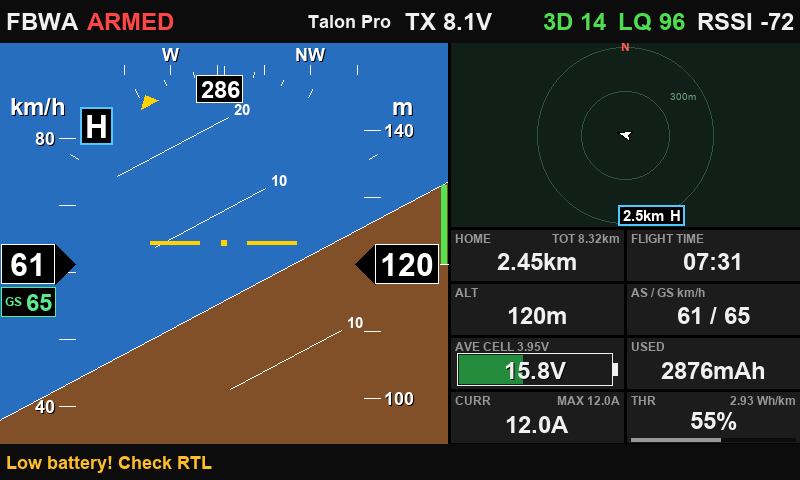

**Status:** 1.0.0, from the [releases page](https://github.com/erwinquilloy/OmniDeck/releases). New since 0.4.1: the [PARAMS page](#params-page-parameter-editor) for **INAV 9.1+** and **Betaflight 4.5, 2025.12 and 2026.6** (it was ArduPilot only), hold - / + to repeat in its editor, a [page switch](#changing-pages) on Ethos and an up / down mode for a 3-position switch, an average-cell battery display, the mLRS bridge on mLRS's own frames, and a layout and touch pass for the TX16S MK3. Every change is in the [changelog](CHANGELOG.md). Companions: [OmniDeck Mono](#omnideck-mono-black-and-white-radios) 0.1.2 for black-and-white radios, and the [OmniDeck Param Editor](https://github.com/erwinquilloy/param-editor) 0.2.1, a parameter tool that also runs on black-and-white radios. The guide with a side outline is at [erwinquilloy.github.io/ardupilot-tools/omnideck.html](https://erwinquilloy.github.io/ardupilot-tools/omnideck.html).

**Chat:** questions, ideas and flight reports on the [Arduplane Stratos Discord](https://discord.gg/NrfaPSpEFp).

## Contents

- [What it does](#what-it-does)
- [Radios and links](#radios-and-links)
- [Parameters and missions: what you need](#parameters-and-missions-what-you-need)
- [Install](#install)
- [Flight controller setup](#flight-controller-setup)
- [Main page and HUD](#main-page-and-hud)
- [Changing pages](#changing-pages)
- [Map](#map)
- [Messages](#messages)
- [Flight summary and stats](#flight-summary-and-stats)
- [Sensor check](#sensor-check)
- [PARAMS page (parameter editor)](#params-page-parameter-editor)
- [On EdgeTX](#on-edgetx)
- [Settings](#settings)
- [Map tiles](#map-tiles)
- [Missions](#missions)
- [Mission editor](#mission-editor)
- [Voice and alarms](#voice-and-alarms)
- [OmniDeck Mono (black-and-white radios)](#omnideck-mono-black-and-white-radios)
- [Reporting a problem](#reporting-a-problem)
- [Development](#development)
- [Credits](#credits)

## What it does

- **Avionics:** artificial horizon with pitch ladder and roll scale, speed and altitude tapes, heading tape with a home marker, vertical speed bar.
- **Map:** vector map with range rings, flight trail, home and waypoints, or satellite and street tiles from the SD card. Aircraft-centred or home-centred, north up or heading up.
- **Data blocks:** distance to home and total distance, flight time, altitude, airspeed and ground speed, battery gauge (pack or average cell voltage), mAh used, current, throttle and live efficiency.
- **Status messages** from ArduPilot with severity colours and a beep. A repeated message shows once with a count.
- **Ready to arm** while disarmed, and voice call-outs for flight modes, arming, battery, failsafes and GPS.
- **Flight summary** on disarm, an optional live **Flight stats** page, and a **flight log** file per flight on the SD card.
- **PARAMS page:** read and change flight controller settings from the radio, in groups: 77 ArduPlane parameters plus rows of your own, 62 INAV settings (INAV 9.1 or later) or 58 Betaflight settings (4.5, 2025.12, 2026.6). Every save is read back to check it.
- **Missions:** the ArduPilot mission downloaded from the aircraft onto the map, a mission editor that makes or changes one and sends it to the aircraft, ArduPilot `.waypoints` files (Ethos) or waypoints learned from telemetry; INAV missions downloaded over the telemetry link.

## Radios and links

| Radio | System | Screen | Status |
|---|---|---|---|
| FrSky X20S (X20 family) | Ethos | 800 x 480 | Tested |
| FrSky X18 | Ethos | 480 x 320 | Tested |
| FrSky X14 | Ethos | 640 x 360 | Simulator only |
| RadioMaster TX16S MK2 | EdgeTX | 480 x 272 | Tested |
| RadioMaster TX16S MK3 / MK3 Max | EdgeTX | 800 x 480 | Tested |
| RadioMaster TX12 MK2 | EdgeTX ([OmniDeck Mono](#omnideck-mono-black-and-white-radios)) | 128 x 64 | Tested (bench) |
| RadioMaster GX12 | EdgeTX (OmniDeck Mono) | 128 x 64 | Tested (tester) |
| RadioMaster Pocket, Boxer | EdgeTX (OmniDeck Mono) | 128 x 64 | Not tested |
| FrSky Taranis X9D, X9D+, X9E | EdgeTX (OmniDeck Mono 0.1.2) | 212 x 64 | Simulator only |
| OpenTX colour radios | OpenTX 2.3 | 480 x 272 | (in progress) |

ArduPilot sends FrSky passthrough telemetry (the same data Yaapu uses) over every link. INAV and Betaflight are read from the radio's own telemetry sensors.

| Link | Radio | ArduPilot | INAV | Betaflight |
|---|---|---|---|---|
| TBS Crossfire (CRSF) | Ethos, EdgeTX | Tested | Tested | Tested |
| ExpressLRS (CRSF) | Ethos, EdgeTX | Tested | Tested | Tested |
| mLRS (CRSF passthrough) | Ethos, EdgeTX | Tested | Tested | Not tested |
| FrSky F.Port (R9, Archer 2.4) | Ethos | Tested | Tested | Not tested |
| FrSky S.Port | Ethos | Not tested | Not tested | Not tested |

"Not tested" means the combination has not been checked on a radio yet, not that it is known not to work.

- **ArduPilot** (Plane, including QuadPlane; Copter mode names included): attitude, GPS, home, battery and capacity, flight mode, armed and flying flags, failsafes, waypoint, wind and status messages. Flight time counts only while ArduPilot reports it is flying.
- **INAV** (tested with 7 and 9): attitude, GPS, altitude, speeds, battery, flight mode and ready to arm. Airspeed only with a pitot, real or virtual. No status messages. Flight time counts from arming.
- **Betaflight:** attitude, GPS, speed, battery, flight mode, and ready to arm from the CRSF flight mode text. No airspeed and no status messages.
- **Throttle:** ArduPilot sends its real throttle output. INAV and Betaflight send none, so THR shows your radio's throttle stick (0 to 100 %), which can differ from the motor in INAV's automatic modes.

### ArduPilot over TBS Crossfire at 50 Hz

**A slow, steppy display at 50 Hz is normal, and Yaapu behaves the same way.** TBS Crossfire drops to its 50 Hz RF mode when you force it, or on the Dynamic profile when the signal weakens. At 50 Hz the return link from the receiver to the radio is very narrow: ArduPilot sends its telemetry (horizon, speeds, altitude, flight mode, battery) only once every 3 seconds, and that data also waits in the link, so the radio's horizon can run a few seconds behind the aircraft. Your goggles' OSD is not affected: the flight controller draws it, and it travels on the video link. Mission Planner over USB is not affected either.

What OmniDeck does about it (since 0.3.0), once ArduPilot has reported a TBS link below 150 Hz (its `CRSFv3: Link rate 50Hz` message) and the first 3-second pause has been seen:

- no NO TELEMETRY flash between bursts, speeds stay on screen, and READY TO ARM works;
- ground speed, satellites and distance to home update every second, and voltage, current and mAh every 2 s, from the standard Crossfire GPS and battery sensors (discover them on the radio once);
- the horizon, airspeed, altitude and flight mode can only update as fast as ArduPilot sends them.

ELRS, mLRS, F.Port and S.Port are not affected. **For a live horizon on the radio, force Crossfire to 150 Hz on the transmitter.**

## Parameters and missions: what you need

The [PARAMS page](#params-page-parameter-editor), the [ArduPilot mission download](#missions) and the [mission editor](#mission-editor)'s Send don't just listen to telemetry: they send requests to ArduPilot and wait for its answers. That needs a link that carries messages both ways, and on some links firmware that answers them. These are the three paths tested on a radio:

| Path | Link | PARAMS page | Mission download and Send | What it needs |
|---|---|---|---|---|
| **FrSky MAVlite** | FrSky S.Port or F.Port, ArduPilot passthrough | Any ArduPilot | ArduPlane Stratos v2.2.1 or later | ArduPilot answers parameter requests over FrSky passthrough (MAVlite) out of the box. The mission messages are a Stratos addition |
| **MAVlite over CRSF** | ExpressLRS (Link Mode Normal), TBS Crossfire at 150 Hz | ArduPlane Stratos v2.2.1 or later | ArduPlane Stratos v2.2.1 or later | Stratos carries MAVlite over CRSF. Proposed for upstream ArduPilot as [ArduPilot#35160](https://github.com/ArduPilot/ardupilot/pull/35160) (parameters), still pending: upstream ArduPilot doesn't answer over CRSF yet |
| **mLRS CRSF bridge** | mLRS with **Tx Ser Port = cbridge** | Any ArduPilot | Any ArduPilot | mLRS 1.4.04 (pre-release) or later. OmniDeck speaks standard MAVLink through the module, so no firmware support is needed |

**Get Stratos v2.2.1:** [ArduPlane Stratos](https://github.com/erwinquilloy/ardupilot) is an ArduPlane fork. Download [v2.2.1 full](https://github.com/erwinquilloy/ardupilot/releases/tag/full-v2.2.1) for 2 MB flight controllers (F7, H7) or [v2.2.1 light](https://github.com/erwinquilloy/ardupilot/releases/tag/light-v2.2.1) for 1 MB F4 boards; each release lists its boards and which file to flash.

**Staying on upstream ArduPilot?** Over S.Port / F.Port the PARAMS page works as it is, and mLRS with cbridge works for everything. Parameters over CRSF need the pull request [ArduPilot#35160](https://github.com/ArduPilot/ardupilot/pull/35160) ("AP_RCTelemetry: carry MAVlite parameter messages over CRSF"), still open: follow or support it there. Missions over CRSF and FrSky are Stratos only for now.

**Setting up each path**

- **FrSky S.Port / F.Port:** nothing beyond the telemetry setup (`SERIALn_PROTOCOL 10` for S.Port, `23` for F.Port). For the mission download and Send, flash Stratos v2.2.1 or later ([full](https://github.com/erwinquilloy/ardupilot/releases/tag/full-v2.2.1) · [light](https://github.com/erwinquilloy/ardupilot/releases/tag/light-v2.2.1)).
- **ExpressLRS / TBS Crossfire:** flash Stratos v2.2.1 or later ([full](https://github.com/erwinquilloy/ardupilot/releases/tag/full-v2.2.1) · [light](https://github.com/erwinquilloy/ardupilot/releases/tag/light-v2.2.1)) and keep the telemetry setup (`RC_OPTIONS` bit 8, CRSF passthrough). ExpressLRS: **Link Mode Normal**, 150 Hz packet rate or faster. Crossfire: **150 Hz forced**; at 50 Hz the link is too slow for these requests for now.
- **mLRS:** update the module to 1.4.04 (pre-release) or later. In the mLRS Lua script, Tx section, set **Tx Ser Port = cbridge**, then store and reboot the module. The screens keep their telemetry as before. **Tx Ser Port2** has no cbridge in mLRS 1.4 and can stay on wbridge for Mission Planner over WiFi. Checked on a RadioMaster Nomad.

**Not supported**

- **ExpressLRS in MAVLink mode** (ELRS Lua "Link Mode" = MAVLink), with any firmware: the receiver passes only MAVLink to the flight controller, so OmniDeck's requests never arrive, and the module turns only telemetry back into CRSF. Switch Link Mode to Normal, or use S.Port / F.Port or mLRS. The telemetry screens still work in MAVLink mode, as fast as ArduPilot sends MAVLink on that port (1 Hz by default: raise `MAVn_EXTRA1`, `MAVn_EXTRA2` and `MAVn_EXT_STAT`).
- **TBS Crossfire at 50 Hz:** too slow for now. Force 150 Hz.
- **INAV and Betaflight:** the mission editor is ArduPilot only. INAV missions still [download onto the map](#missions). Their PARAMS page has its own needs, below.

**INAV and Betaflight**

The PARAMS page talks MSP to INAV and Betaflight, over the same telemetry link:

| Flight controller | Versions | Links |
|---|---|---|
| INAV | 9.1.0 or later | ExpressLRS (Link Mode Normal), TBS Crossfire at 150 Hz, S.Port / F.Port. mLRS (Tx Ser Port = cbridge, Rx Ser Link Mode = mspX) needs MSP over the CRSF bridge, merged for the next mLRS release ([mLRS#560](https://github.com/olliw42/mLRS/pull/560)). Until it is out, a custom mLRS Tx build is available on request |
| Betaflight | 4.5, 2025.12 and 2026.6 | ExpressLRS (Link Mode Normal), TBS Crossfire at 150 Hz, S.Port / F.Port. 2026.6 checked on a quad over ExpressLRS |

- **INAV 7 and 8** can't carry the setting commands over the radio link, and **INAV 9.0.x** answers them without the values (fixed in 9.1.0): the page says "Parameters need INAV 9.1 or later".
- **Betaflight** has no settings by name over MSP, only fixed blocks of bytes whose layout can change between versions. OmniDeck knows the layouts of 4.5, 2025.12 and 2026.6; any other version gets "Parameters need Betaflight 4.5, 2025.12 or 2026.6" with the version it found, and nothing is written. For those, use Betaflight Configurator.

When requests go out and no answer comes back, the PARAMS page says **"The flight controller doesn't answer"**, with a hint for the link in use.

## Install

Download the package for your radio from the [releases page](https://github.com/erwinquilloy/OmniDeck/releases) and unzip it on the PC; the Ethos Suite zip goes to Ethos Suite as it is, unopened. The other two zips each hold an `INSTALL.txt` with the same steps.

| Package | For |
|---|---|
| `OmniDeck_Ethos_Suite_1.0.0.zip` | Any Ethos colour radio, installed with **Ethos Suite**. Holds both screen sizes; the radio picks the right one. |
| `OmniDeck_Ethos_1.0.0.zip` | The same Ethos files, to copy onto the radio by hand. |
| `OmniDeck_Ethos_1.0.0_X18_update.zip` | X18 owners updating who already have the voice packs: the X18 code only, no X20 code and no audio. |
| `OmniDeck_EdgeTX_1.0.0.zip` | EdgeTX colour radios: TX16S MK2 (480 x 272), MK3 and MK3 Max (800 x 480). |

**No SD card?** On radios that keep everything on built-in storage, the same folders go on the radio's internal drive: the one that already holds `scripts` (Ethos) or `WIDGETS` (EdgeTX). Wherever this guide says "card", read that drive. Put map tiles on the same drive as OmniDeck, and check the free space first: a satellite tile set can run to hundreds of MB.

### Ethos

Two ways in: Ethos Suite, or copying the files yourself. Both end with the same `scripts/omnideck/` folder.

**With Ethos Suite** (`OmniDeck_Ethos_Suite_1.0.0.zip`)

1. Connect the radio by USB and start **Ethos Suite**.
2. Open **Lua Library › Install from local .zip** and pick `OmniDeck_Ethos_Suite_1.0.0.zip`. The Suite installs OmniDeck to `scripts/omnideck/` on the radio's SD card or internal storage, whichever the radio uses.
3. Disconnect and restart the radio, then carry on from step 4 below.

The Suite zip carries the `ethos_lua_manifest.json` that current Ethos Suite versions ask for ("No ethos_lua_manifest.json found at zip root" with older OmniDeck Suite zips); older Suites install it too.

If `scripts/omnideck/missions/` isn't there afterwards, make it for your ArduPilot `.waypoints` files; the `logs` folder appears with the first flight log. Map tiles are never in a package; copy them as in [Map tiles](#map-tiles).

**By hand** (`OmniDeck_Ethos_1.0.0.zip`)

1. Connect the radio by USB and choose the SD card, or use a card reader.
2. Copy the `scripts` folder from the package to the **root** of the card. You should end up with:

   ```
   scripts/omnideck/
   ├── main.lua      loader: picks x18/ or x20/ by screen width
   ├── x20/          the code for 800 x 480 screens
   ├── x18/          the code for 480 x 320 and smaller
   ├── audio/        voice packs: Aria, Guy
   ├── tones/        message beeps
   ├── logos/        panel logos; add your own PNG here
   ├── missions/     ArduPilot .waypoints files
   ├── logs/         one text file per flight
   └── params_example.txt   your own PARAMS rows: rename to params.txt
   ```
3. Eject the card and restart the radio.
4. Add **OmniDeck** to a screen with a **full-screen** layout. In a smaller slot it shows only the minimap.
5. Long-press the widget and choose **Configure widget** for the [settings](#settings).

**Updating:** install the newer Suite zip, or copy the new `scripts` folder over the old one. Either way, then delete any `.luac` files in `scripts/omnideck/` and its `x18/`, `x20/` folders so the radio compiles the new code. Coming from test 41 or older: delete the old loose `.lua` files in `scripts/omnideck/` (audio, hud, map, mission, mspclient, summary, telem, tiles, ui) but keep the new `main.lua` and the folders. `lastpos.txt` is no longer used.

### EdgeTX

1. Connect the radio by USB and pick **USB Storage (SD)**, or use a card reader.
2. Copy the `WIDGETS` and `SCRIPTS` folders to the **root** of the card:

   ```
   WIDGETS/OmniDeck/
   ├── main.lua  etx.lua  ui.lua  hud.lua  map.lua ...
   ├── params.lua  plist.lua  medit.lua   PARAMS page and mission editor
   ├── audio/        voice packs: Aria, Guy
   ├── fixed/        pre-drawn panel and HUD frames
   ├── tones/  logos/  missions/
   ├── logs/         one text file per flight
   └── params_example.txt   your own PARAMS rows: rename to params.txt
   SCRIPTS/TOOLS/
   ├── OmniDeck Setup.lua    the settings, per model
   └── OmniDeck Check.lua    load test that shows any error
   ```
3. Eject the card and restart the radio.
4. Add a screen with a **one-zone layout** (no top bar, no sliders, no trims) and pick OmniDeck for the zone, or an **App mode** layout with OmniDeck as its widget.
5. Bring OmniDeck to the front to change pages and zoom (see below): EdgeTX passes touch and keys to a widget only then.
6. Settings: **SYS › Tools › OmniDeck Setup**.

**Full screen or App mode:**

- **One-zone (full screen) layout:** long-press the widget and choose **Full screen**. Then tap the screen or press the scroll wheel's centre button (ENTER) to change pages. Long-press RTN to leave full screen.
- **App mode layout** (TX16S MK3): press and hold the widget screen. The EdgeTX button in the corner goes away, and a screen tap or the scroll wheel's centre button changes pages. To get back to the EdgeTX menus, hold RTN until the EdgeTX button appears again.
- Not in front, a one-zone screen still shows the full display (a small zone only the minimap), and a [page switch](#changing-pages) still turns the pages.

**Updating:** delete the `.luac` files in `WIDGETS/OmniDeck/` first, then copy the new folders. Your settings stay in `WIDGETS/OmniDeck/<model name>.cfg`; settings new in 1.0.0 start Off.

**Not in the widget list?** Run **SYS › Tools › OmniDeck Check**: it loads the widget the way EdgeTX does and shows the exact error.

## Flight controller setup

| Flight controller | Link | Setting |
|---|---|---|
| ArduPilot | CRSF (ELRS, Crossfire) | `RC_OPTIONS` bit 8, CRSF passthrough. With ELRS keep packet rate × telemetry ratio above about 30 telemetry frames a second. |
| ArduPilot | S.Port | `SERIALn_PROTOCOL 10` |
| ArduPilot | F.Port (R9, Archer 2.4) | `SERIALn_PROTOCOL 23` |
| ArduPilot | mLRS | Set the Tx module to send CRSF passthrough to the radio. |
| INAV, Betaflight | CRSF | Normal CRSF telemetry. |
| INAV | S.Port, F.Port | Serial RX, provider `FPORT` (F.Port), half-duplex ON, signal on the UART's TX pad. Turn on **Use Pitch & Roll sensors in telemetry** for the horizon. |

- **INAV and Betaflight:** power the aircraft and run **Model › Telemetry › Discover new sensors** on the radio before using OmniDeck. After changing links, delete the old sensors and discover again.
- **ArduPilot ground speed next to airspeed** needs `FRSKY_OPTIONS` bit 0; otherwise only one of the two is sent.
- **Battery capacity:** ArduPilot sends `BATT_CAPACITY`. For INAV and Betaflight enter the pack size under **Battery mAh (INAV/BF only)**. The battery bar also needs a working current sensor.
- **INAV virtual pitot** sends an estimate as if it were airspeed. Set the pitot to NONE if you would rather see ground speed on the tape.
- **PARAMS page, mission download and mission editor:** see [what you need](#parameters-and-missions-what-you-need) for the firmware and link settings (Stratos v2.2.1 or later over CRSF; Tx Ser Port = cbridge on mLRS).

### Link settings on the transmitter

| Link | Setting |
|---|---|
| ELRS | Telemetry ratio **1:8 or more often** (1:4, 1:2). |
| TBS Crossfire | **Dynamic** or **150 Hz forced**. At 50 Hz the telemetry runs seconds late with any flight controller, and Dynamic drops to 50 Hz far out ([why](#ardupilot-over-tbs-crossfire-at-50-hz)). |
| mLRS, F.Port | The defaults work. |

## Main page and HUD

Yellow pins mark the top bar and the HUD, blue pins the top-right panel and the data blocks.

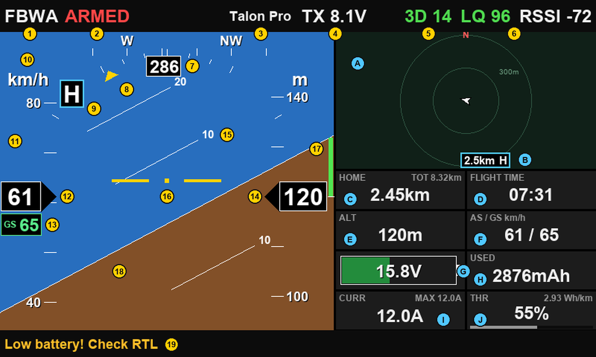

**Top bar**

| | |
|---|---|
| 1 | **Flight mode** as the flight controller names it (FBWA, AUTO, RTL, ANGL, ACRO, AIR...). Spoken on each change. |
| 2 | **Arm state:** ARMED in red, DISARMED in grey. **NO TELEMETRY** replaces both when the link drops. |
| 3 | **Model name** from the radio. |
| 4 | **Radio battery** (TX voltage). |
| 5 | **GPS fix and satellites**, e.g. 3D 14. Green with a 3D fix. ArduPilot's telemetry carries at most 15: over Crossfire or ELRS the real count comes from the Crossfire GPS sensor, over S.Port or F.Port it shows 15+. |
| 6 | **Link quality and RSSI** from the receiver. |

**HUD**

| | |
|---|---|
| 7 | **Heading box and compass strip:** heading in degrees, with N, NE, E... on the strip above it. |
| 8 | **Roll scale and pointer:** ticks around the top of the horizon; the yellow pointer shows the bank angle. |
| 9 | **Home marker H:** where home is relative to the nose. The strip's full width is ±90°; past that the H parks at the end on home's side (turn that way), and it hides only when home is within 5° of the tail. |
| 10 | **Speed unit** for the speed tape (km/h, m/s, kn or mph). The altitude tape on the right has its own (m or ft). |
| 11 | **Speed tape:** airspeed when the aircraft sends it. With no airspeed (no pitot, Betaflight) it shows ground speed. |
| 12 | **Speed value box:** black for airspeed, green when the tape is showing ground speed. |
| 13 | **GS box:** ground speed under the airspeed box, when both are available. |
| 14 | **Altitude tape and value box:** altitude above home. |
| 15 | **Pitch ladder:** a line every 10°, short marks at 5°. |
| 16 | **Aircraft symbol:** the yellow wings and dot; the horizon moves around it. |
| 17 | **Vertical speed bar** on the HUD's right edge: green climbing, orange sinking, full at ±5 m/s. |
| 18 | **Sky and ground.** While disarmed the arming state shows here, under the aircraft symbol. |
| 19 | **Latest status message** in the bottom bar, coloured by severity. |

**Top-right panel and data blocks**

| | |
|---|---|
| A | **Top-right panel**, by default the minimap: range rings, aircraft, home and (on Ethos) trail and mission. |
| B | **Home badge:** the H in a blue-framed box. When home is off the minimap it sits on the edge with the distance to home. |
| C | **HOME:** distance to home. The small TOT note is the total distance flown. |
| D | **FLIGHT TIME:** white while the clock runs. After a disarm the last flight's time stays, dimmed, until the next arming. |
| E | **ALT:** altitude now. |
| F | **AS / GS:** airspeed and ground speed now. GS alone when there is no airspeed. |
| G | **Battery:** capacity left as a bar, voltage on top. Green, amber below 30 %, red below 15 % or on a battery failsafe. |
| H | **USED:** mAh drawn from the pack. |
| I | **CURR:** current now, with the flight's maximum. |
| J | **THR:** throttle with a bar, and the live efficiency in the corner. |

### Top-right panel choices

Setting **Main page top-right panel** (Ethos) or **Top-right panel** (EdgeTX Setup):

| Choice | What it shows |
|---|---|
| Minimap | The default. Range rings, aircraft, home badge; trail and mission on Ethos. |
| Home arrow | The OmniDeck logo before arming, then a large arrow pointing home. Up means home is straight ahead. |
| Radar | Home and aircraft on a radar disc, in the style of iNav LuaTelemetry. |
| OmniDeck logo | The logo only. |
| Logo file (Ethos) · Stratos logo (EdgeTX) | On Ethos, any PNG in `scripts/omnideck/logos/`, picked under **Logo file**. |

| | |
|---|---|
| 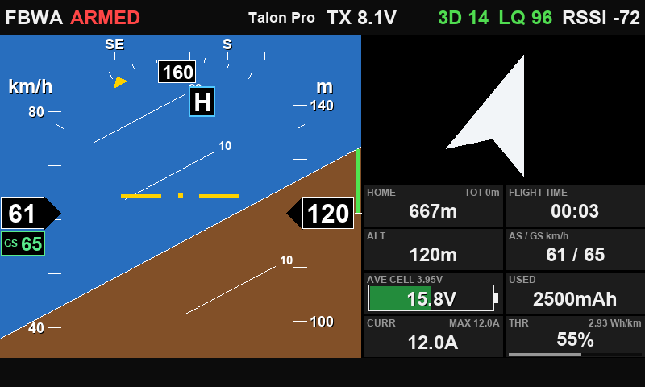 | 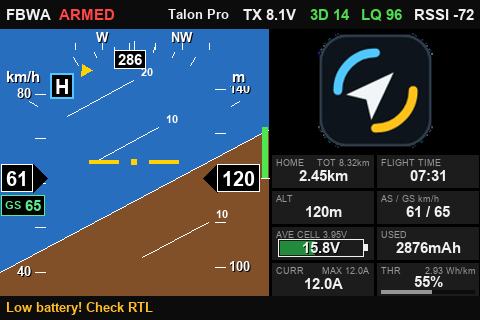 |
| Home arrow panel: home is about 20° to the right. | X18 (480 x 320) with the OmniDeck logo panel. |

### Arming states

| | |
|---|---|
| 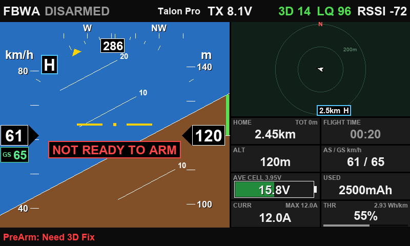 | 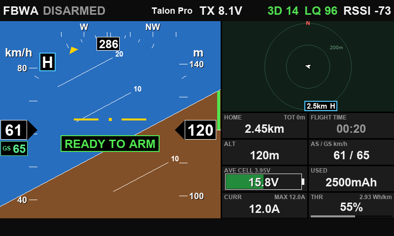 |
| NOT READY TO ARM, with the PreArm reason in the bottom bar. | READY TO ARM. The dimmed 00:20 is the last flight's time. |

INAV and Betaflight report ready-to-arm themselves. ArduPilot sends no such flag, so OmniDeck works it out: NOT READY holds for 40 s after a PreArm or critical message, and while a fitted GPS has no 3D fix, the EKF reports a problem or a failsafe is active. READY needs 40 s disarmed with none of these. Until then it shows CHECKING ARMING. The flight controller still has the last word.

### INAV and Betaflight

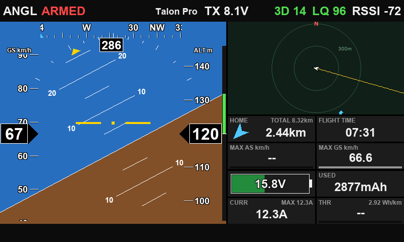

INAV in ANGL mode with no pitot: the speed box is green because the tape shows ground speed, and the AS / GS block shows GS alone. THR is the radio's throttle stick.

## Changing pages

Tap the screen or press ENTER for the next page. The wheel zooms the map and scrolls the messages. On EdgeTX this works in full screen.

A **Page switch** turns the pages with a switch on the radio, also when OmniDeck is not full screen: on Ethos in the widget settings, on EdgeTX in OmniDeck Setup. **Page switch action** picks how:

- **Up previous, down next:** for a 3-position switch. Flip up = one page back, flip down = one page on, the middle does nothing and the page stays. The default on Ethos.
- **Next page (flip up / press):** one page on with each flip, or each press of a momentary switch such as SH. The default on EdgeTX.
- **Position picks page:** a 3-position switch, up = Main, middle = Map, down = Messages.

| Page | In the cycle |
|---|---|
| Main | Always. |
| Map | Always. |
| Messages | Setting **Messages page**: Auto (ArduPilot only, the default), On or Off. |
| Flight stats | Setting **Flight stats page**, Off by default. On: always in the cycle, live during the flight. |
| Sensor check | Setting **Sensor check page**, Off by default. Turn it on when you report a problem. |
| PARAMS | Setting **Params page (ArduPilot, INAV)**, Off by default. ArduPilot, INAV 9.1+ and Betaflight 4.5 / 2025.12 / 2026.6. ENTER and the wheel work inside the page; RTN leaves it (see [keys](#keys-and-touch)). |

The **flight summary** opens by itself on disarm (if **Flight summary on disarm** is On and the aircraft was armed for at least 10 s) and goes back to the main page after 15 s. Tap or turn to another page to leave sooner.

## Map

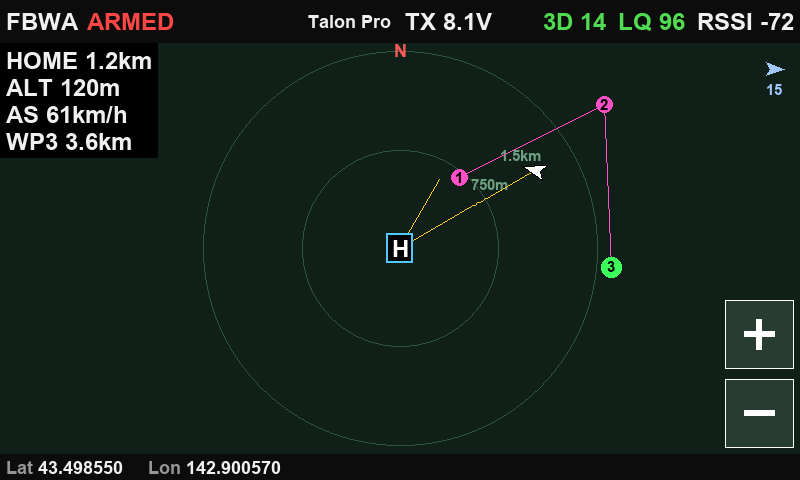

- **Info box** (top left): distance to home, altitude, airspeed, the active waypoint and its distance, and the tile set with its zoom when tiles are on.
- **Wind** (top right): the blue arrow and its speed.
- **Range rings** with their distances. The map zooms itself; + and − or the wheel zoom by hand. A tap near a button or in the gap between them counts as that button; a tap elsewhere on the map changes page.
- **Trail** in yellow. The **H** badge marks home; off the map it waits on the edge with the distance.
- **Bottom bar:** the aircraft's latitude and longitude.
- **Map view** and **Map orientation** settings: aircraft-centred or home-centred, north up or heading up. A tiled map is always north up.
- **EDIT** (lower right, with **ArduPilot mission download** On and an ArduPilot flight controller): opens the [mission editor](#mission-editor) on EdgeTX colour radios and the Ethos X20 family.

| | |
|---|---|
| 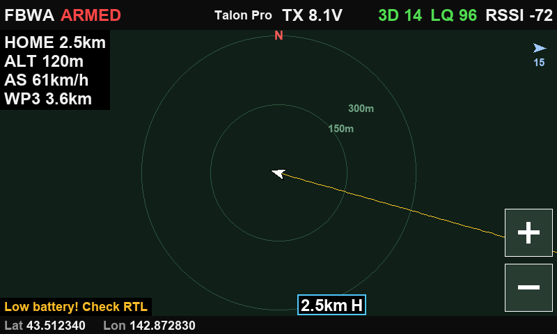 | 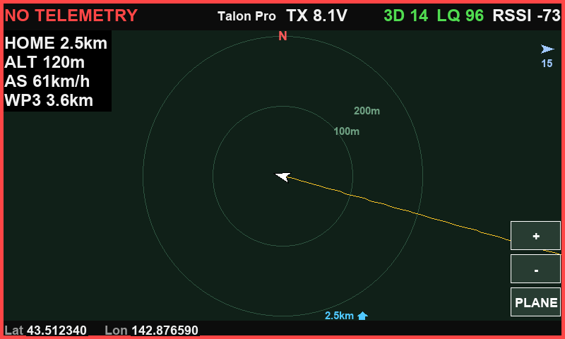 |
| Aircraft-centred, north up, home off to the south. | Telemetry lost: red frame, NO TELEMETRY, last position kept. |

## Messages

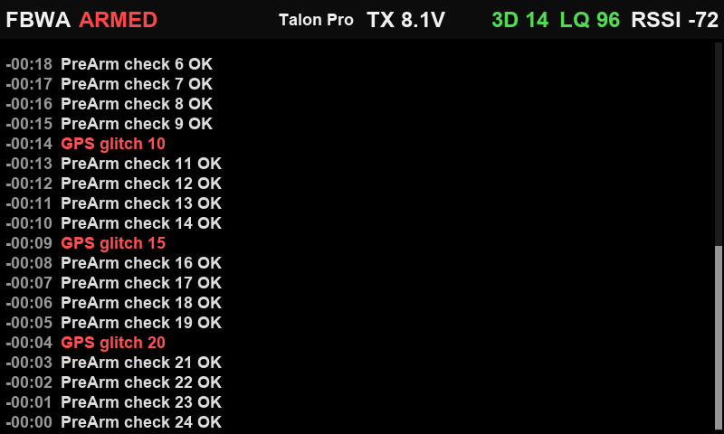

- ArduPilot status messages, newest at the bottom, each with how long ago it arrived. Errors in red, warnings in amber.
- The same message repeated shows once, with a count.
- The wheel scrolls back; the bar on the right shows where you are.
- **Message beep:** one blip for info, a double beep for a warning, a two-tone alarm for an error. A burst gives one beep.

## Flight summary and stats

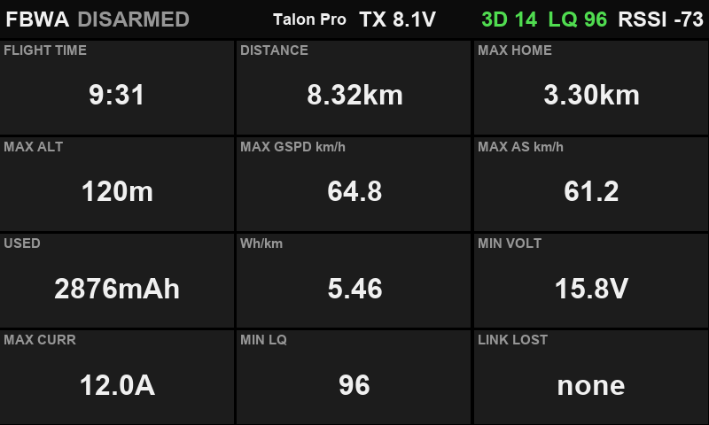

Flight time, distance flown, furthest from home, maximum altitude, ground speed and airspeed, mAh used, efficiency, lowest voltage, maximum current, lowest link quality, and link losses. With **Flight stats page** On the same page is in the cycle during the flight (FLIGHT TIME (NOW), figures so far), and says "No flight yet" before the first one.

**Flight logs:** at each disarm after at least 10 s armed, the flight is saved as its own text file, `<model>-<YYYY-MM-DD>-<HHMMSS>.txt`, whether or not the summary page is set to open. It holds the date and time, model, flight controller and link, the summary's figures, home, the last position and the last 10 messages. Ethos: `scripts/omnideck/logs/`. EdgeTX: `WIDGETS/OmniDeck/logs/`. The date and time come from the radio's clock: set it once in the radio's settings, or every log is dated 2000-01-01 (common on a TX16S).

## Sensor check

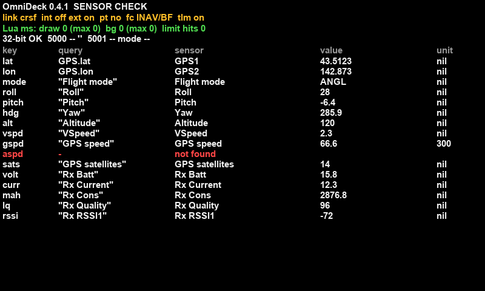

Each value, the radio sensor it comes from, and its reading. "not found" in red means the radio has no such sensor (here INAV with no pitot, so no airspeed). The header shows the version, the link, whether passthrough is arriving, the flight controller type and the Lua time per update. Turn it on with **Sensor check page** and send a photo of it with any report.

When the rows don't all fit (smaller screens such as the TX16S MK2, or the extra S.Port and EdgeTX link lines in the header), the list scrolls under the header: turn the wheel, or drag up and down. A scrollbar at the right edge shows there is more. A tap still turns the page.

With ArduPilot and the PARAMS page or mission download On, the header also has a **Params:** line (messages sent, received and bad, and how many `params.txt` rows were read) and, once a mission is downloaded, **mission: N items**. Include them in a report about the PARAMS page or the mission editor.

## PARAMS page (parameter editor)

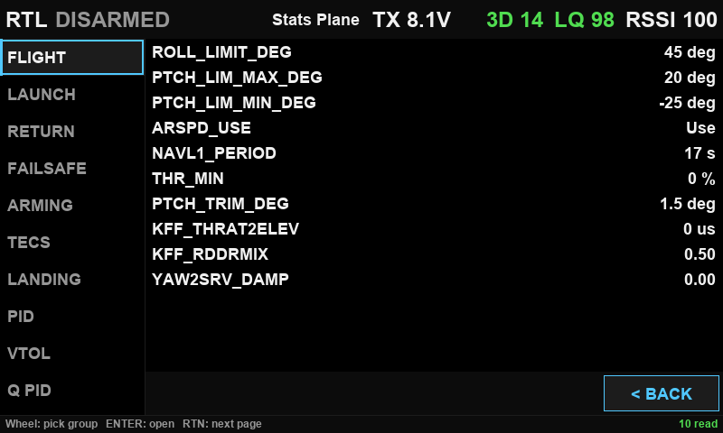

Read and change flight controller settings from the radio at the field, without a laptop: ArduPilot (ArduPlane parameters), [INAV](#inav-settings) 9.1 or later and [Betaflight](#betaflight-settings) 4.5, 2025.12 or 2026.6. Turn it on with **Params page (ArduPilot, INAV)** (Off by default); the page then joins the page cycle whenever the flight controller is one of them. It works on every colour radio: Ethos X20 family, X18, and EdgeTX. Check [what you need](#parameters-and-missions-what-you-need) first: over S.Port and F.Port any ArduPilot answers; over ELRS and Crossfire it needs ArduPlane Stratos v2.2.1 or later; over mLRS, the cbridge setting. On black-and-white radios use the [OmniDeck Param Editor](https://github.com/erwinquilloy/param-editor).

### Groups

The left column holds the groups, the right column the open group's rows: name, value and unit. The ArduPilot groups:

| Group | Parameters |
|---|---|
| FLIGHT | `ROLL_LIMIT_DEG`, `PTCH_LIM_MAX_DEG`, `PTCH_LIM_MIN_DEG`, `ARSPD_USE`, `NAVL1_PERIOD`, `THR_MIN`, `PTCH_TRIM_DEG`, `KFF_THRAT2ELEV`, `KFF_RDDRMIX`, `YAW2SRV_DAMP` |
| LAUNCH | `TKOFF_ALT`, `TKOFF_LVL_PITCH`, `TKOFF_THR_MINACC`, `TKOFF_THR_DELAY`, `TKOFF_THR_MAX` |
| RETURN | `RTL_ALTITUDE`, `RTL_RADIUS`, `WP_LOITER_RAD`, `RTL_AUTOLAND` |
| FAILSAFE | `FS_SHORT_ACTN`, `FS_LONG_ACTN`, `FS_LONG_TIMEOUT`, `BATT_LOW_VOLT`, `BATT_CRT_VOLT`, `BATT_FS_LOW_ACT` |
| ARMING | `ARMING_SKIPCHK` (as a list of checks), `ARMING_RUDDER`, `ARMING_REQUIRE` |
| TECS | `TRIM_THROTTLE`, `AIRSPEED_CRUISE`, `THR_MAX`, `AIRSPEED_MAX`, `TECS_PITCH_MAX`, `TECS_CLMB_MAX`, `FBWB_CLIMB_RATE`, `AIRSPEED_MIN`, `STAB_PITCH_DOWN`, `TECS_SINK_MIN`, `TECS_PITCH_MIN`, `TECS_SINK_MAX`, `KFF_THR2PTCH`: the TECS tuning helper's results, in its order |
| LANDING | `LAND_FLARE_ALT`, `LAND_FLARE_SEC`, `LAND_PITCH_DEG`, `TECS_LAND_ARSPD` |
| PID | `RLL_RATE_P`, `_I`, `_D`, `_FF`, `PTCH_RATE_P`, `_I`, `_D`, `_FF`, `RLL2SRV_TCONST`, `PTCH2SRV_TCONST`, `RLL2SRV_RMAX`, `PTCH2SRV_RMAX_UP`, `PTCH2SRV_RMAX_DN`, `AUTOTUNE_LEVEL` |
| VTOL | `Q_ASSIST_SPEED`, `Q_ASSIST_ALT`, `Q_RTL_MODE`, `Q_TRANSITION_MS`, `Q_LAND_FINAL_SPD`, `Q_FS_EKF_HOLD`, `Q_A_ANGLE_MAX` |
| Q PID | `Q_A_RAT_RLL_P`, `_I`, `_D`, `Q_A_RAT_PIT_P`, `_I`, `_D`, `Q_A_RAT_YAW_P`, `_I`, `Q_A_ANG_RLL_P`, `Q_A_ANG_PIT_P`, `Q_A_ANG_YAW_P` |

VTOL and Q PID show only on a quadplane (`Q_ENABLE` 1). Choice parameters such as `ARSPD_USE`, `RTL_AUTOLAND` or `FS_LONG_ACTN` show their meaning ("Use", "RTL") rather than a number. A parameter the flight controller doesn't have shows **n/a** (for example `Q_FS_EKF_HOLD`, which only Stratos has); ENTER on an n/a row asks once more.

### Reading

- **Only the open group is read**, one value at a time, the selected row first. Values already read are kept when you open another group, so going back is instant.
- While a group is read, a thin bar under the top bar and **reading n/m** in the lower right show how far it is; **n read** when done. A row not read yet shows **...**.
- Values are read only while the page is open. Telemetry keeps coming in while it reads.
- The page's code leaves the radio's memory 10 s after you leave the page (it stays while the mission download or the editor uses it), so the other pages keep their speed.

### Keys and touch

| Where | Wheel | ENTER | RTN | Touch |
|---|---|---|---|---|
| Group column (left) | Moves the highlight. Nothing is opened or read | Opens the group, cursor on its first row | Next page | Tap a group to open it |
| Rows (right) | Moves the cursor, inside the open group | Opens the editor for that row | Back to the group column | Tap a row to edit it |
| Editor | Changes the value by its step | Saves | Back, without saving | **-**, **+** (hold to repeat), **Back**, **Save** (X18: also **-10**, **+10**) |

- **< BACK** in the lower right does the same as RTN. When a group has more rows than fit, up and down arrows appear left of it; groups that fit show none.
- A tap that hits no button does nothing, so the page is never left by a missed tap. Leave it with RTN or BACK: once from the group column, twice from a group's rows. Only the "doesn't answer" screen, which has no buttons, turns the page on a tap.
- The bottom line shows the keys for where you are.
- **Leaving the page drops a change you didn't save:** turn the page (RTN, a page switch, the summary at disarm) with the editor open and the value is thrown away; coming back shows the flight controller's value. A Save already pressed still goes through.
- **Hold - or +** (and -10 / +10 on the X18) and the value keeps stepping: after half a second, 10 steps a second, faster after 2.5 s, until you lift the finger or slide it off the button. A tap is still one step, and nothing is sent before Save.
- **X18 (480 x 320):** larger groups and rows for touch; drag either column to scroll.

| | |
|---|---|
| 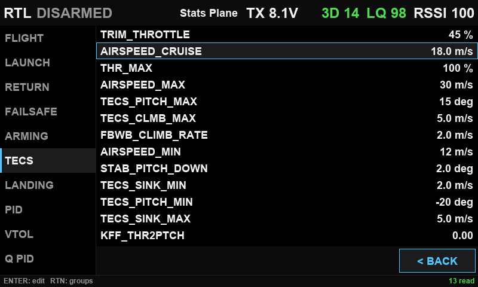 | 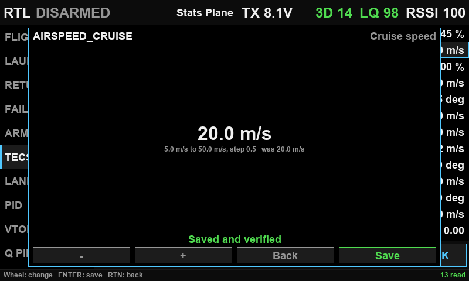 |
| The TECS group open, cursor on `AIRSPEED_CRUISE`. | The editor: name, description, range and step, and the value before. **Saved and verified** after Save. |

### Editing and saving

1. Open the group, move to the row and press ENTER (or tap the row).
2. Turn the wheel, or tap **-** and **+**. The editor shows the allowed range, the step and the value before you started (**was**).
3. Press ENTER or tap **Save**.

- A save is sent **once**. **Saved and verified** shows only when the value read back from the flight controller matches.
- **No answer: check the value in a GCS** means no reply came. OmniDeck never repeats a save by itself.
- **Not saved: FC has ...** means ArduPilot kept another value, for example one outside its own limits.
- Rows whose lowest value is -1 (`Q_ASSIST_SPEED`, `RTL_ALTITUDE`, `TECS_LAND_ARSPD`) step between 0 and -1.
- ArduPilot stores the value at once, as from a GCS. Some parameters only take effect after a reboot, as in Mission Planner.

### Armed and in flight

- **While armed the page is view only:** the editor opens but says **Armed: view only**, and nothing is written.
- Setting **Params: edit in flight** = **Gains and trim** lets the PID and Q PID rows, `PTCH_TRIM_DEG` and `KFF_THRAT2ELEV` be changed while armed (INAV and Betaflight: see their sections). Change one wheel click at a time, with height to spare, as when tuning from a GCS.

### ARMING_SKIPCHK

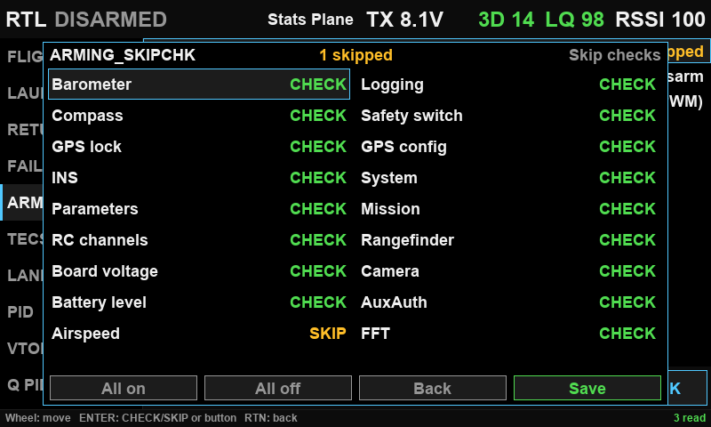

`ARMING_SKIPCHK` opens as a list of ArduPlane's arming checks, each **CHECK** or **SKIP**, with the number skipped at the top. The wheel moves through the checks and the buttons, ENTER flips a check or presses a button; or tap a check to flip it. **All on** checks everything (0); **All off** skips every check (-1, shown as ALL SKIPPED). Save writes the new value.

### Your own rows: params.txt

Add parameters the built-in list doesn't have with a `params.txt` file, one for all models: `scripts/omnideck/params.txt` on Ethos, `WIDGETS/OmniDeck/params.txt` on EdgeTX. The package has a `params_example.txt` next to it with the rules; rename it to `params.txt` to start from it.

```
[PID] flight
YAW_RATE_P | Yaw P | 0.005

[NAV]
NAVL1_DAMPING | L1 damping | 0.05
WP_RADIUS | WP radius | 5
```

- `[GROUP]` puts the rows below it in that group. A built-in name (PID, TECS, ...) adds to it; a new name makes a new group after the built-in ones. `[GROUP] flight` lets its rows be changed in flight with **Gains and trim**.
- Each row is `NAME`, optionally `| label | step` (the editor text and the wheel step). Without a step the wheel moves 1 for whole numbers, otherwise about 1 % of the value. Rows have no range of their own; ArduPilot keeps its limits.
- Rows before any `[GROUP]` go to OTHER. `Q_` rows show only when `Q_ENABLE` is 1. A name already in the list is skipped.
- At most 100 rows and 14 groups. Restart the radio, or select the model again, after editing. The Sensor check page's **Params:** line shows how many rows were read and the first line that couldn't be.

### INAV settings

| | |
|---|---|
| 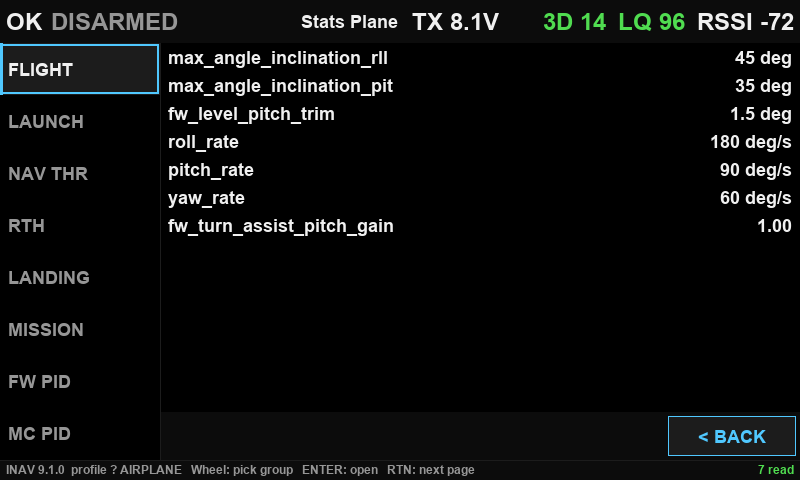 | 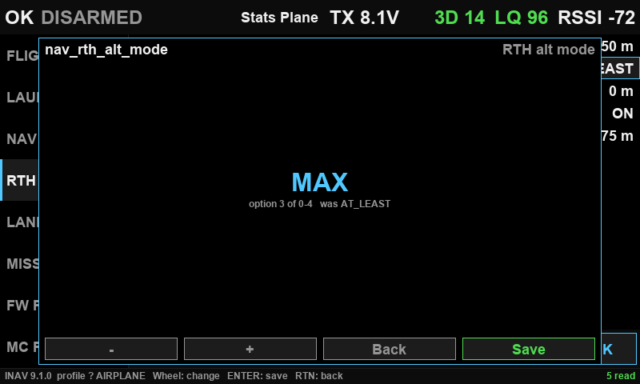 |
| INAV 9.1, FLIGHT group: CLI names, plain units. | A choice setting (`nav_rth_alt_mode`) by name, with the value before. |

With INAV 9.1 or later the page reads and changes INAV settings by their CLI names, shown in plain units (degrees, m, m/s) where INAV stores decidegrees, cm and cm/s. Ranges and choice names (for example RTH alt mode AT_LEAST / MAX) come from the flight controller; a setting it doesn't have shows n/a.

| Group | Settings |
|---|---|
| FLIGHT | `max_angle_inclination_rll`, `max_angle_inclination_pit`, `fw_level_pitch_trim`, `roll_rate`, `pitch_rate`, `yaw_rate`, `fw_turn_assist_pitch_gain` |
| LAUNCH | `nav_fw_launch_thr`, `nav_fw_launch_idle_thr`, `nav_fw_launch_accel`, `nav_fw_launch_climb_angle`, `nav_fw_launch_motor_delay`, `nav_fw_launch_max_altitude`, `nav_fw_launch_max_angle` |
| NAV | `nav_fw_cruise_thr`, `nav_fw_min_thr`, `nav_fw_max_thr`, `nav_fw_pitch2thr`, `nav_fw_climb_angle`, `nav_fw_dive_angle`, `nav_fw_bank_angle`, `nav_fw_cruise_speed`, `nav_fw_allow_manual_thr_increase`, `nav_fw_loiter_radius` |
| RTH | `nav_rth_altitude`, `nav_rth_alt_mode`, `nav_rth_home_altitude`, `nav_rth_climb_first` |
| LANDING | `nav_fw_land_approach_length`, `nav_fw_land_glide_alt`, `nav_fw_land_flare_alt`, `nav_fw_land_glide_pitch`, `nav_fw_land_flare_pitch` |
| MISSION | `nav_wp_radius`, `nav_auto_speed`, `nav_max_auto_speed`, `nav_extra_arming_safety` |
| FW PID | `fw_p_roll`, `_i`, `_d`, `_ff`, `fw_p_pitch`, `_i`, `_d`, `_ff`, `fw_p_yaw`, `_i`, `_ff`, `tpa_rate`, `tpa_breakpoint`, `fw_tpa_time_constant` |
| MC PID | `mc_p_roll`, `_i`, `_d`, `mc_p_pitch`, `_i`, `_d`, `mc_p_yaw`, `_i`, `nav_mc_hover_thr`, `nav_land_maxalt_vspd`, `nav_land_minalt_vspd` |

- **Save:** INAV sets the value, OmniDeck reads it back, then stores it in EEPROM while disarmed: **Saved, verified and stored**.
- **In flight:** OmniDeck asks INAV itself whether it is armed. With **Params: edit in flight** = **Gains and trim**, the PID groups, level trim and hover throttle can be changed; they work at once and are stored after the disarm, on any page. The hint line shows **NOT STORED** until then. Keep the radio linked a few seconds after the disarm before unplugging the battery.
- **VTOL** (`mixer_control_profile_linking` ON): INAV reads and writes the active profile only, shown on the hint line (for example "profile 2 MULTIROTOR"). Hover PIDs (MC PID) can be changed only in multirotor mode and plane PIDs (FW PID) only in fixed-wing mode; flip the VTOL switch on the bench, disarmed, to edit the other set.
- The INAV mission download pauses while the page talks to INAV.

### Betaflight settings

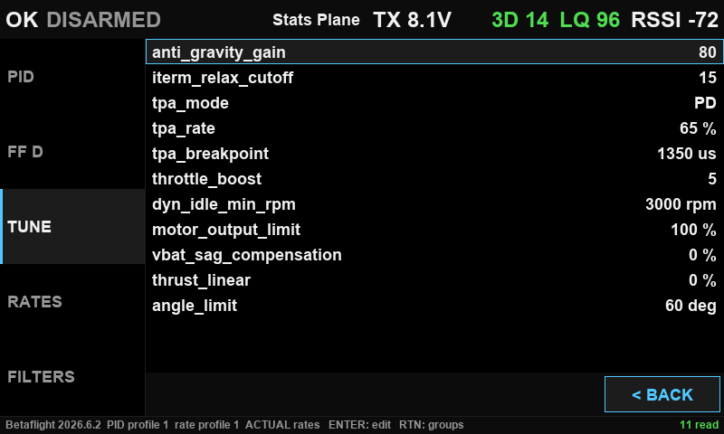

Betaflight 2026.6, the TUNE group; the hint line shows the version, the PID and rate profile and the rates type.

With Betaflight 4.5, 2025.12 or 2026.6 the page reads and changes 58 settings of the **active** PID and rate profile, named as in the Betaflight CLI. Choice settings show by name (TPA mode PD / D, throttle limit OFF / SCALE / CLIP).

| Group | Settings |
|---|---|
| PID | `p_`, `i_`, `d_` for roll, pitch and yaw |
| FF D | `f_roll`, `f_pitch`, `f_yaw`; `d_max_roll`, `_pitch`, `_yaw`, `d_max_gain` (4.5: `d_min_...`); `feedforward_transition`, `_averaging`, `_smooth_factor`, `_jitter_factor`, `_boost`, `_max_rate_limit` |
| TUNE | `anti_gravity_gain`, `iterm_relax_cutoff`, `tpa_mode`, `tpa_rate`, `tpa_breakpoint`, `throttle_boost`, `dyn_idle_min_rpm` (in rpm), `motor_output_limit`, `vbat_sag_compensation`, `thrust_linear`, `angle_limit` |
| RATES | RC rate, super rate and expo per axis (labels follow the rates type: Actual shows center / max rate in deg/s), `thr_mid`, `thr_expo`, `throttle_limit_type`, `throttle_limit_percent` |
| FILTERS | gyro and D-term lowpass, dynamic notch (count, Q, min, max), RPM filter (harmonics, min) |

- **Save:** the block is read fresh, only that setting changed, sent back up to the end of its group, read back, then stored in EEPROM while disarmed: **Saved, verified and stored**. Everything else in the block is left as it was.
- The hint line shows the version, the PID and rate profile and the rates type. Switch profiles in Betaflight; the page follows.
- A build without the dynamic notch or RPM filter shows those rows as n/a.
- **In flight:** the same rules as INAV. With **Gains and trim** these can be changed while armed: PID, FF D (FF averaging aside) and the TUNE gains: anti gravity, I-term relax cutoff, TPA rate and breakpoint, throttle boost. Rates, filters, TPA mode and the motor, idle and angle settings are view only while armed.

## On EdgeTX

| | | |
|---|---|---|
| 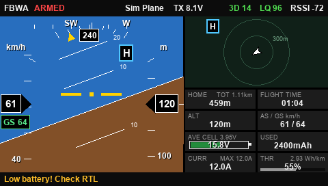 | 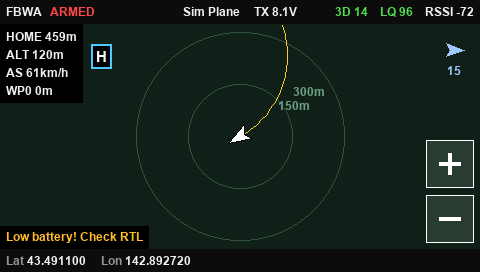 | 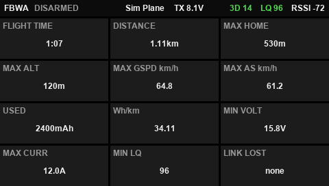 |

The same pages, drawn a little lighter: the main-page minimap has no trail or mission (the Map page has both), the tapes label every other step and the pitch ladder is labelled on one side.

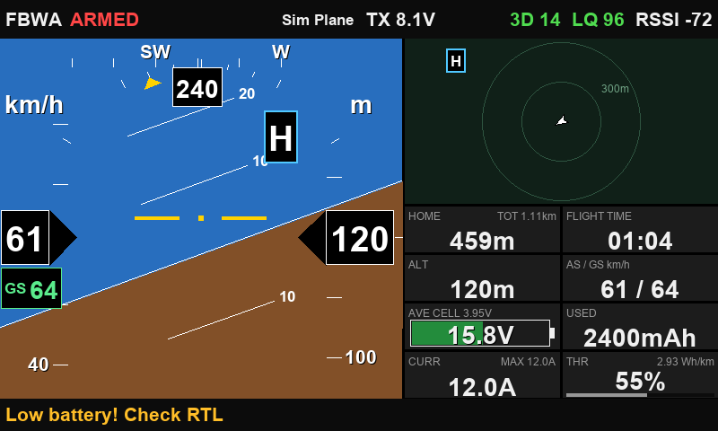

The PARAMS page and the mission editor work the same on EdgeTX, in full screen. The editor's buttons fit the 480 x 272 screen of the TX16S MK2.

| | |
|---|---|
| 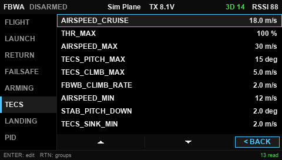 | 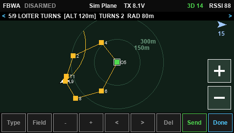 |
| PARAMS page on a TX16S MK2: the TECS group, with row arrows and BACK in the bottom row. | Mission editor on a TX16S MK2: a loiter-turns item selected. |

### EdgeTX versions and the CPU limit

EdgeTX stops a widget whose screen update runs more than about 20,000 Lua instructions (the "CPU limit" message). It counts instructions, not time, so a faster radio gets no extra room. Ethos has no such limit. OmniDeck lets EdgeTX draw the horizon ground and clipped lines in C where the version allows it.

| EdgeTX | Horizon ground in C | Clipped lines in C | Heaviest main-page update |
|---|---|---|---|
| 2.11, 2.12 | Yes | All | 72 % of the limit |
| 2.9, 2.10 | Yes | Only lines with no part left of or above the screen | 73 % of the limit |

0.4.1, worst case in the EdgeTX simulator (`tools/sim_edgetx.py`, run as EdgeTX 2.12.0 and 2.9.4): ArduPilot over CRSF with a 120-waypoint mission. The heaviest page of all is the map over S.Port while the ArduPilot mission is downloaded and edited: 80 % on 2.9, 77 % on 2.12. The PARAMS page peaks at 56 %, INAV at 62 %. The 800 x 480 screen costs the same as 480 x 272.

**Recommendation:** use EdgeTX 2.11 or later, ideally the latest 2.12.x. Keep the radio's own telemetry alarms and the flight controller's failsafes as your safety net; OmniDeck is a display. Since 2.11.1, EdgeTX refuses sound files whose path is longer than 45 characters: the bundled packs fit, and your own pack's folder name should be 4 letters or fewer.

## Settings

On Ethos: long-press the widget › **Configure widget**. On EdgeTX: **SYS › Tools › OmniDeck Setup**, saved per model to `WIDGETS/OmniDeck/<model name>.cfg`; the widget itself has one option, **Page**, to fix a page per screen.

| | | |
|---|---|---|
| 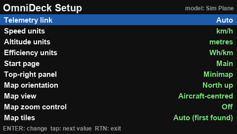 | 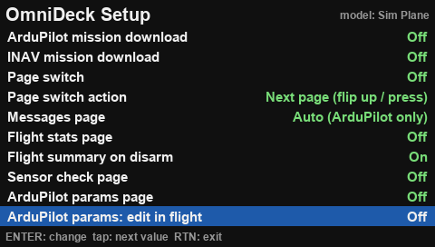 | 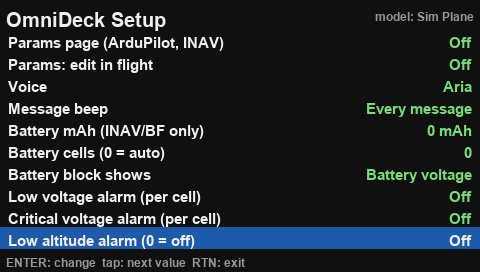 |
| Link, units, main page and map. | Missions, pages (with the page switch) and the parameter settings. | Parameters, voice, battery and alarms. |

The list is grouped the same way on both systems: link, units, main page, map, missions, pages, parameters, then voice and alarms. Settings new in 1.0.0 start Off, apart from the page switch action on Ethos (Up previous, down next).

| Setting | Choices | Notes |
|---|---|---|
| **Link** | | |
| Telemetry link | Auto · CRSF / ELRS / mLRS · S.Port / F.Port / FBUS | Auto picks the link whose sensors are receiving. |
| **Units** | | |
| Speed units | km/h · m/s · knots · mph | |
| Altitude units | metres · feet | |
| Efficiency units | Wh/km · mAh/km · Wh/mi · mAh/mi | Shown in the THR block and the summary. |
| **Main page** | | |
| Start page | Main · Map | |
| Main page top-right panel (Ethos) · Top-right panel (EdgeTX) | Minimap · Home arrow · Radar · OmniDeck logo · Logo file / Stratos logo | See [Top-right panel choices](#top-right-panel-choices). |
| Logo file (Ethos) | None · PNGs in `logos/` | For the Logo file panel. It fills the panel, proportions kept. |
| Battery block shows | Battery voltage · Average cell | Average cell: the gauge shows the cell voltage and a small line the pack (BATT 15.8V); otherwise the other way round (AVE CELL 3.95V). The cell count comes from **Battery cells**, or from the voltage. |
| **Map** | | |
| Map orientation | North up · Heading up | A tiled map is always north up. |
| Map view | Aircraft centred · Home centred | Home centred zooms out to keep the aircraft on the map. |
| Zoom source (Ethos) · Map zoom control (EdgeTX) | A pot, slider or switch | Optional manual zoom. |
| Map tiles | Off · the tile sets found on the card | EdgeTX also has Auto, the first set found. |
| Flight trail | On · Off | Ethos has a button to clear the trail and learned waypoints. |
| **Missions** | | |
| Mission file (Ethos) | None · `.waypoints` files | ArduPilot; without a file, waypoints are learned from telemetry. |
| ArduPilot mission download | Off · On | Off by default. The aircraft's mission on the map, and the map page's EDIT button for the [mission editor](#mission-editor). Needs [one of these paths](#parameters-and-missions-what-you-need). Off takes the mission off the map again. |
| INAV mission download | Off · On | Off by default. Ethos also has a Re-download button. |
| **Pages** | | |
| Page switch, Page switch action | A switch · Up previous, down next · Next page (flip up / press) · Position picks page | Changes page outside full screen too; see [Changing pages](#changing-pages). On Ethos new in 1.0.0, Up previous, down next by default. |
| Messages page | Auto (ArduPilot only) · On · Off | |
| Flight stats page | Off · On | On: in the cycle, live in flight. |
| Flight summary on disarm | On · Off | |
| Sensor check page | Off · On | |
| **Parameters** | | |
| Params page (ArduPilot, INAV) | Off · On | Off by default. Puts the [PARAMS page](#params-page-parameter-editor) in the cycle for ArduPilot, INAV and Betaflight. (Was "ArduPilot params page".) |
| Params: edit in flight | Off · Gains and trim | Off: view only while armed. Gains and trim: the PID and trim rows can be changed in flight. (Was "ArduPilot params: edit in flight".) |
| **Voice and alarms** | | |
| Voice | Off · voice packs on the card | Picking one plays a test clip. |
| Message beep | Every message · Warnings and errors · Off | Works with the voice off. |
| Battery mAh (INAV/BF only) | 0 to 50,000 (EdgeTX 30,000) | ArduPilot sends its own capacity. |
| Battery cells | 0 = auto, up to 14 | Set it for Li-ion or a part-charged pack. |
| Low / Critical voltage alarm | Volts per cell, 0 = off | "Low voltage" every 30 s, "Critical voltage" every 15 s, after 5 s below. |
| Low altitude alarm | 0 = off, up to 3,000 | "Terrain, pull up" when armed and below it, after having been above it once. |

## Map tiles

Without tiles you get a vector map with range rings. For satellite or street maps, OmniDeck reads the tile folders used by the [ETHOS Mapping Widget](https://github.com/b14ckyy/ETHOSMappingWidget-Revisited), so tiles made for it, and Yaapu's Google tiles, work as they are. You don't need the Mapping Widget itself.

1. On a PC open the [High Resolution Map Generator](https://martinovem.github.io/High-Resolution-Map-Generator/) in Chrome or Edge.
2. Set **Output Target** to **b14ckyy ETHOS Mapping Widget**.
3. Pick the provider and map type, for example Google Satellite, and a zoom range such as 12 to 17. Draw a box larger than the area you fly in.
4. Save or extract the result. It is a `maps` folder with provider, type and zoom folders inside.
5. Copy that `maps` folder to the path for your radio below. Capitals matter: `GOOGLE/Satellite`, not `google/satellite`.
6. Restart the radio and pick the set under **Map tiles**. Only sets found on the card are listed, with their zoom range.

### Ethos

```
bitmaps/ethosmaps/maps/            <- the generator's "maps" folder goes here
├── GOOGLE/
│   └── Satellite/
│       ├── 12/ ... 17/            one folder per zoom level
│       │   └── 117554/            tile column (x)
│       │       └── 47906.jpg      tile row (y)
├── ESRI/   OSM/   MAPTILER/
bitmaps/yaapu/maps/                Yaapu Google tiles, as they are
```

One tile: `/bitmaps/ethosmaps/maps/GOOGLE/Satellite/15/27470/15200.jpg`. The `bitmaps` folder sits at the root of the same drive as `scripts`; create it if there is none.

### EdgeTX

```
IMAGES/ethosmaps/maps/             <- IMAGES, not bitmaps
├── GOOGLE/Satellite/15/27470/15200.jpg
├── ESRI/   OSM/   MAPTILER/
IMAGES/yaapu/maps/                 Yaapu Google tiles
```

One tile: `/IMAGES/ethosmaps/maps/GOOGLE/Satellite/15/27470/15200.jpg`. In OmniDeck Setup › **Map tiles**: Auto (first set found), Off, or a set by name.

- JPG tiles load fastest; PNG works too.
- Ethos queues a whole screen of tiles in a few updates, nearest the aircraft first. EdgeTX loads two per update.

## Missions

- **INAV:** with **INAV mission download** turned on (it is off by default), OmniDeck downloads the mission from the flight controller over the telemetry link (CRSF/ELRS or S.Port), a few seconds after the link comes up.
  - Waypoints show numbered, holds as H and landings as L; the active waypoint is green.
  - A mission uploaded after the radio started shows within about 10 s while the aircraft is disarmed.
  - Only the first mission on the flight controller is shown. **Save it to EEPROM** in INAV Configurator, or the flight controller won't have it after a power cycle.
- **ArduPilot, downloaded from the aircraft:** turn on **ArduPilot mission download** (Off by default). It needs [one of these paths](#parameters-and-missions-what-you-need): ArduPlane Stratos v2.2.1 or later over S.Port, F.Port, ELRS or Crossfire at 150 Hz, or any ArduPilot over mLRS with cbridge.
  - The whole mission draws on the map (and on the Ethos minimap), each item numbered as in Mission Planner, with T before the takeoff and L before a landing (T1, L9); the active waypoint is green. Items without a position (speed change, land start, jump, RTL) are in the mission but not on the map.
  - While disarmed OmniDeck checks every 10 s whether the mission changed, for example after an upload from Mission Planner, and downloads it again. The first download also works armed.
  - Up to 100 items. The Sensor check page shows **mission: N items**.
  - It takes over from a mission file and from learned waypoints. Turning the setting Off takes it off the map again.
  - On EdgeTX colour radios and the Ethos X20 family, the map page's **EDIT** button opens the [mission editor](#mission-editor). The X18 shows the mission but has no editor.
- **ArduPilot, without the download:**
  - **Ethos:** copy a Mission Planner / QGC `.waypoints` file to `scripts/omnideck/missions/` and pick it under **Mission file**; the whole route draws, with the active waypoint in green.
  - **Without a file, and on EdgeTX:** each waypoint is placed on the map when it becomes active, from ArduPilot's distance and bearing to it, so the route builds up as you fly.
- **Betaflight:** no missions.

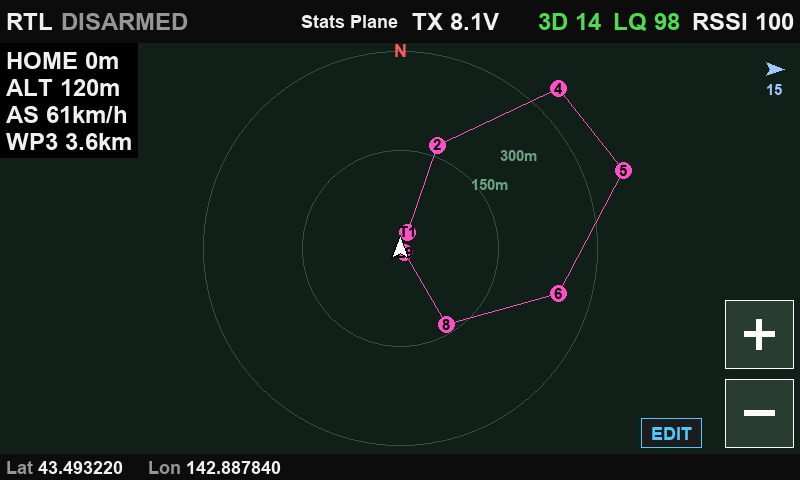

A downloaded mission on the X20 map page: takeoff T1, waypoints 2, 4 and 6, loiter 5, approach waypoint 8 and the landing L9 (under the aircraft). Items 3 (speed change) and 7 (land start) have no position. EDIT is in the lower right.

## Mission editor

Make a mission on the radio, or change the one on the aircraft, and send it, without a laptop. On **EdgeTX colour radios** (TX16S MK2 480 x 272, MK3 and MK3 Max 800 x 480) and the **Ethos X20 family**. The X18's screen is too small for it.

**Needs:** **ArduPilot mission download** On, an ArduPilot flight controller, and for Send [one of these paths](#parameters-and-missions-what-you-need): ArduPlane Stratos v2.2.1 or later over S.Port, F.Port, ELRS or Crossfire at 150 Hz, or any ArduPilot over mLRS with cbridge.

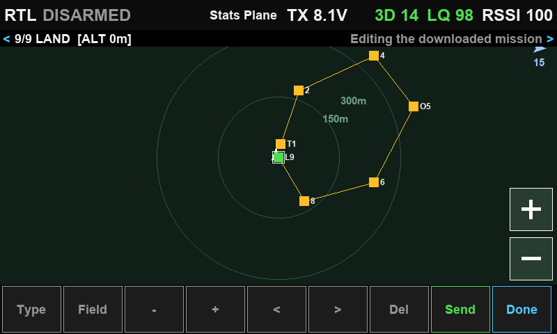

### The screen

- **Info line** (under the top bar): the selected item as **number/total**, its type and its values, for example `5/9 LOITER TURNS [ALT 120m] TURNS 2 RAD 80m`. The field that **-** and **+** change is in brackets. **<** and **>** at its ends: tap the left or right third of the line for the previous or next item, including the ones not on the map.
- **Map:** the route in yellow, the selected item in green. The map centres on the selected item; for an item without a position, on the nearest one before it. The aircraft and home stay where they are. **+** and **-** on the right zoom.
- **Buttons** along the bottom: **Type**, **Field**, **-**, **+**, **<**, **>**, **Del**, **Send**, **Done**.

### Start

1. On the map page, tap **EDIT**.
2. The editor opens on the downloaded mission (**Editing the downloaded mission**), or on a new one with a takeoff at home (**New mission**) when the aircraft has none.

A downloaded mission with commands the editor can't keep, such as servo or camera commands, is not opened: editing would drop them. Make a new one (Del twice on the takeoff) or change it in a GCS.

### Make and change items

| To | Do |
|---|---|
| Add a waypoint | Tap the map where it should go. It goes after the selected item, at the altitude of the last waypoint or loiter before it (100 m if there is none). |
| Select an item | Tap its point on the map, or tap the left / right third of the info line. ENTER selects the next item. |
| Change its type | **Type** steps through Waypoint, Loiter (unlimited), Loiter turns, Loiter time, Land, RTL, Speed change, Land start and Jump. On a quadplane (`Q_ENABLE` 1) also VTOL land and Transition, and Type on the first item switches Takeoff and VTOL takeoff. |
| Change a value | **Field** picks the value, **-** and **+** change it; the wheel changes it in half steps. |
| Move it in the list | **<** and **>** move it earlier or later. The takeoff stays first. |
| Delete it | **Del**. The item before it becomes selected, so a tap on the map puts a new point in its place: to move a waypoint, Del it and tap where it should be. |
| Start again | **Del** twice on the takeoff (within 4 s): a new mission with only the takeoff. |

| Field | Items | - / + | Wheel |
|---|---|---|---|
| Altitude | Waypoint, loiters, land, takeoff | 1 m | 1 m |
| Turns | Loiter turns | 1 | 1 |
| Radius | Loiter unlimited, loiter turns (0 = `WP_LOITER_RAD`) | 10 m | 5 m |
| Time | Loiter time | 10 s | 5 s |
| Speed | Speed change (airspeed; -1 = no change) | 1 m/s, shown in your speed units | 1 m/s |
| Target, Repeat | Jump: the item number to jump to, and how often (-1 = forever) | 1 | 1 |
| Direction | Transition: to fixed wing or to VTOL | toggles | toggles |

A timed loiter has no radius of its own: ArduPilot uses `WP_LOITER_RAD` for it. A mission holds up to 60 items in the editor.

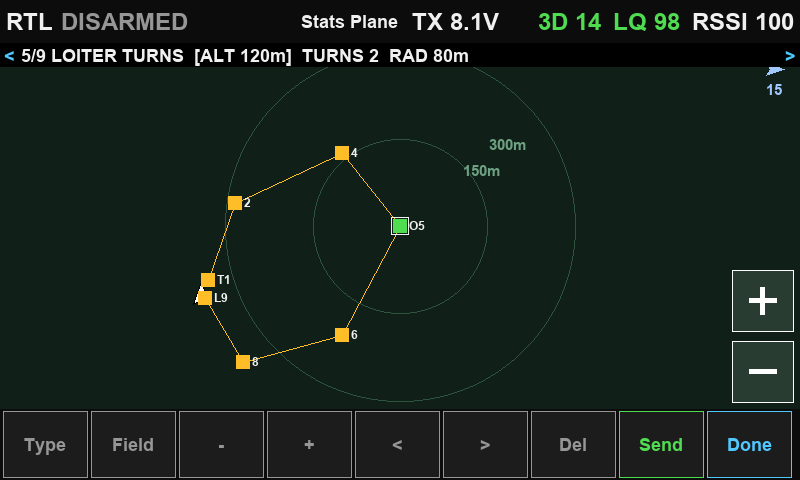

### Send

1. Disarm. Send is refused while armed ("Disarm to send"), and ArduPilot refuses it too.
2. Tap **Send**. OmniDeck clears the mission on the aircraft, writes it item by item (**Sending n/m**), then downloads it again and compares.
3. **Sent and verified**: the aircraft holds exactly what is on the screen. **Refused: ...** shows ArduPilot's reason (each item goes through ArduPilot's own checks, as an upload from Mission Planner). **No answer: check the mission in a GCS** means the link dropped part way.

Over mLRS, Send uses ArduPilot's standard mission upload, the same as Mission Planner. Home stays as it is on the aircraft.

### Leave

**Done** or RTN leaves the editor. A mission not sent is dropped; the map shows the aircraft's mission again.

**Before flying a mission made on the radio**, check it on the map once more, and in a GCS when you can. As with any mission upload, the aircraft flies what it holds.

## Voice and alarms

- **Call-outs:** flight modes, arm and disarm, battery percent (50, 40, 30, 25, 20, 15, 10 and 5 % while armed), failsafes, GPS fix changes, telemetry lost and recovered, ready and not ready to arm, and status messages worth hearing, such as "Takeoff complete".
- **Voice packs:** Aria and Guy come with both packages, in `scripts/omnideck/audio/` on Ethos and `WIDGETS/OmniDeck/audio/` on EdgeTX. A copy of Yaapu's English sound folder there also works, because the file names match.
- **Alarms:** low and critical voltage per cell, and the low-altitude "Terrain, pull up". See [Settings](#settings).

## OmniDeck Mono (black-and-white radios)

OmniDeck Mono is OmniDeck for EdgeTX radios with a black-and-white screen: 128 x 64, and from 0.1.2 also 212 x 64 (Taranis X9D, X9D+, X9E). It decodes telemetry the same way as the colour builds, for ArduPilot, INAV and Betaflight over CRSF (ExpressLRS, TBS Crossfire, mLRS), S.Port and F.Port, and fits it on six small pages. It runs as an EdgeTX **telemetry screen script**, not a widget.

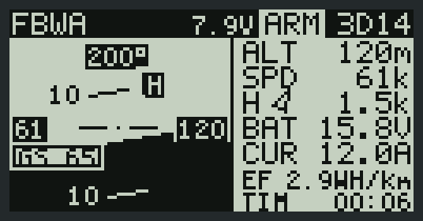

**Status:** 0.1.2, beta. Bench-tested on a TX12 MK2 (EdgeTX 2.12) with ArduPilot and INAV over ExpressLRS, and over mLRS 1.4.04, and tested by a tester on a RadioMaster GX12. Not yet tried on the Pocket or Boxer. 0.1.2 uses the whole width of 212 x 64 screens (Taranis X9D, X9D+, X9E), checked in the simulator but not yet on a Taranis; on 128 x 64 it looks the same as 0.1.1.

**Full guide: [OmniDeck Mono](docs/mono/README.md)** (install, keys, every page, settings, memory, problems).

- **Download:** `OmniDeck_Mono_0.1.2.zip` from the [OmniDeck Mono release](https://github.com/erwinquilloy/OmniDeck/releases/tag/mono-v0.1.2). Copy its `SCRIPTS` folder to the root of the SD card, then **MODEL › DISPLAY**, a screen, **Script**, **omnid**. Keep the `.luac` files: the radio runs out of memory compiling the telemetry code itself.
- **Pages:** Main (horizon, heading and home marker, and a labelled column: ALT, SPD, H, BAT, CUR, EF, TIM), Map (aircraft- or home-centred, wheel zoom, coordinates), Messages (ArduPilot), Flight stats (optional), Link check, Sensor check (optional). ENTER moves to the next page. The flight summary opens by itself at disarm and goes back to the start page after 15 s, and a flight log can be written to the SD card.
- **Settings:** SYS › Tools › OmniDeck Setup, per model: voice, message beeps, units, summary, flight log, voltage and low-altitude alarms, pack capacity, start page, map view, optional pages and link.
- **Units:** `m`, `km` above 999 m, `k` for km and km/h, `ft`, `mi`, `WH/km` and the rest as set in Setup.
- **Parameters:** use the [OmniDeck Param Editor](https://github.com/erwinquilloy/param-editor) (ArduPilot, INAV 9.1+, Betaflight 4.5 / 2025.12 / 2026.6; SYS › Tools › OmniDeck Params); OmniDeck Mono has no editor of its own.
- **Memory:** about 127 KB of Lua memory on a TX12 MK2; OmniDeck Mono 0.1.0 used about 97 to 107 KB, and 0.1.1 about 15 KB less; the Link check page shows it. Pages load one at a time.
- **Compared with the colour builds:** no map tiles, only the active waypoint on the map, no mission files or INAV mission download, no touch or tapes.

## Reporting a problem

Post it on the [Arduplane Stratos Discord](https://discord.gg/NrfaPSpEFp) with the radio model and its Ethos or EdgeTX version, the flight controller and its version, the link, and a photo of the **Sensor check** page. For a script error, send the exact text.

- **No telemetry on INAV or Betaflight:** discover the sensors again on the radio with the aircraft powered.
- **Horizon level on INAV over S.Port or F.Port:** turn on **Use Pitch & Roll sensors in telemetry** in INAV.
- **Flight time 00:00 on ArduPilot on the bench:** expected. It only counts while ArduPilot reports it is flying.
- **No flight summary:** the aircraft has to be armed for at least 10 s.
- **Tiles not listed:** check the folder path and capitals, then restart the radio.
- **Display steps every few seconds on TBS Crossfire with ArduPilot:** Crossfire is in its 50 Hz mode; see [ArduPilot over TBS Crossfire at 50 Hz](#ardupilot-over-tbs-crossfire-at-50-hz). Force 150 Hz on the transmitter for a smooth horizon.
- **EdgeTX "CPU limit" or widget missing:** run OmniDeck Check; update to EdgeTX 2.11 or later.
- **PARAMS page says "The flight controller doesn't answer":** check [what you need](#parameters-and-missions-what-you-need). Over ELRS or Crossfire it needs ArduPlane Stratos v2.2.1 or later; over mLRS, Tx Ser Port = cbridge; ELRS in MAVLink mode and Crossfire at 50 Hz can't carry it. Over S.Port / F.Port check the passthrough setting on the receiver's port.
- **PARAMS page says "Parameters need INAV 9.1 or later" or "Parameters need Betaflight 4.5, 2025.12 or 2026.6":** the flight controller's version is one the page can't work with (it names the version it found). Update it, or use INAV or Betaflight Configurator.
- **Rows stay "..." or turn "n/a" over a weak link:** ENTER on an n/a row asks again. "n/a" on a strong link means the flight controller has no such parameter.
- **No mission on the map with ArduPilot mission download On:** the same requirements as the PARAMS page, but the download needs Stratos v2.2.1 or later on every link except mLRS.

## Development

The shared code in `scripts/omnideck/` runs on Ethos as it is. On EdgeTX, `edgetx/WIDGETS/OmniDeck/etx.lua` provides the Ethos-style calls over EdgeTX's, and all shared modules stay valid Lua 5.2.

- **Ethos simulator:** `python tools/sim.py [outdir] [--sport] [--native] [--tiles] [--res 800x480|480x320|480x272]` runs the widget in Lua 5.4 (lupa) against a stubbed Ethos API, feeds a simulated flight encoded as `AP_Frsky_SPort_Passthrough.cpp` does (or native sensors with `--native`), checks the decoded values and renders every page to PNG.
- **EdgeTX simulator:** `python tools/sim_edgetx.py [outdir] [--sport] [--native]` runs it in Lua 5.2 with EdgeTX's instruction limit (about 20,000 Lua instructions per widget call) and checks decoding, pages, touch, sound, link loss, the Setup tool and a 120-waypoint mission. The heaviest page must stay within 88 % of the limit.
- **EdgeTX build:** `python tools/build_edgetx.py <SD root> [--audio <voice folders>]` writes `WIDGETS/OmniDeck/` and the tools.
- **Voice packs:** `python tools/voicepack.py <folder> Aria Guy` builds packs from `tools/phrases.psv`.

## Credits

OmniDeck is written by Erwin Quilloy. It builds on what these projects worked out first; their code was read as reference.

- **[Yaapu FrSky Telemetry Script](https://github.com/yaapu/FrskyTelemetryScript)** by Alessandro Apostoli (yaapu): ArduPilot passthrough decoding, status-text and sound handling, and the flight timer that follows ArduPilot's flying flag. Its sound file names let Yaapu voice folders work as OmniDeck packs.
- **[ETHOS Mapping Widget Revisited](https://github.com/b14ckyy/ETHOSMappingWidget-Revisited)** by Marc Hoffmann (b14ckyy): the tile folder layout OmniDeck reads, and Ethos file and settings-storage behaviour. Originally by yaapu.
- **[High Resolution Map Generator](https://github.com/MartinovEm/High-Resolution-Map-Generator)** by Emiliyan Martinov (MartinovEm): the web tool that makes the map tiles.
- **[INAV Telemetry Dashboard for Ethos](https://github.com/iNavFlight/ETHOS-Telemetry-Dashboard)** by Rob Thomson (iNavFlight): INAV and Betaflight sensor names over CRSF and S.Port, flight-mode and arming decoding, and creating the sensors Ethos doesn't discover on R9.
- **[iNav OpenTX Telemetry Widget](https://github.com/iNavFlight/OpenTX-Telemetry-Widget)** (iNavFlight): how INAV flight time is counted, from arming.
- **dashx Project:** reading Ethos's own telemetry-lost flag, so a lost link shows at once.
- **[LeoBar (leobarua)](https://github.com/leobarua):** hardware.
- **[Marcin J (jaroszmm)](https://github.com/jaroszmm):** contributor and tester.
- **Testers:** thank you to everyone who tested the pre-release builds and sent feedback.
- **Voices:** Aria and Guy are generated with Microsoft Edge text-to-speech voices.

## Licence

OmniDeck is free software under the [GNU General Public License v3.0](LICENSE).

## Support

OmniDeck is free. If it helps you fly, a coffee keeps it going: PayPal [$10](https://paypal.me/iamwinq/10USD) · [any amount](https://paypal.me/iamwinq), or [Ko-fi](https://ko-fi.com/windfpv).
