# OmniDeck Mono

OmniDeck for EdgeTX radios with a 128 × 64 black-and-white screen. A free telemetry script for ArduPilot, INAV and Betaflight: horizon, map, messages, flight summary, flight log and voice call-outs, on six small pages.

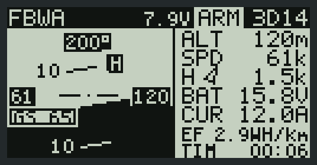

**Status:** 0.1.1, beta. Bench-tested on a RadioMaster TX12 MK2 (EdgeTX 2.12) with ArduPilot and INAV over ExpressLRS, and over mLRS 1.4.04. Not flown yet, and not yet tried on the Pocket or Boxer.

Questions, ideas and flight reports: chat with us on the [Arduplane Stratos Discord](https://discord.gg/NrfaPSpEFp).

## Contents

- [Radios and links](#radios-and-links)
- [Install](#install)
- [Keys](#keys)
- [Main page](#main-page)
- [Pages](#pages)
- [Map](#map)
- [Flight summary and log](#flight-summary-and-log)
- [Voice and alarms](#voice-and-alarms)
- [Settings](#settings)
- [ArduPilot parameters](#ardupilot-parameters)
- [Memory](#memory)
- [Problems](#problems)
- [Test status](#test-status)
- [Compared with colour OmniDeck](#compared-with-colour-omnideck)
- [Support](#support)

## Radios and links

| Radio | Screen | Status |
|---|---|---|
| RadioMaster TX12 MK2 | 128 × 64 | Tested (bench) |
| RadioMaster Pocket, Boxer | 128 × 64 | Not tested |

| Flight controller | Links |
|---|---|
| ArduPilot | FrSky passthrough over CRSF (ExpressLRS, TBS Crossfire, mLRS), S.Port, F.Port |
| INAV, Betaflight | The radio's own telemetry sensors over CRSF or S.Port |

## Install

1. Download `OmniDeck_Mono_0.1.1.zip` from the [OmniDeck Mono release](https://github.com/erwinquilloy/OmniDeck/releases/tag/mono-v0.1.1).
2. Connect the radio by USB and pick **USB Storage (SD)**, or put the card in a card reader.
3. Copy the `SCRIPTS` folder from the zip to the **root** of the card, merging with the folder already there:

   ```
   SCRIPTS/
   ├── TELEMETRY/omnid.luac        the telemetry script
   ├── OMNID/
   │   ├── telem.luac etx.luac pmain.luac …   compiled pages and decoders
   │   ├── audio/                  voice packs: Aria, Guy
   │   ├── tones/                  info, warn, crit beeps
   │   └── logs/                   one text file per flight, if turned on
   └── TOOLS/
       └── OmniDeck Setup.lua      settings, saved per model
   ```

4. On the model: **MODEL › DISPLAY**, pick a screen, set it to **Script** and choose **omnid**.
5. Open it from the main screen with the radio's telemetry key (**TELE** on the TX12 MK2).
6. Optional: run **SYS › Tools › OmniDeck Setup** once per model to pick units, voice and alarms.

> **Keep the `.luac` files.** The telemetry code ships compiled because the radio runs out of memory compiling it itself ("not enough memory"). Don't put `telem.lua` on the card.

**Updating:** copy the new `SCRIPTS` folder over the old one and replace the files. Your per-model settings in `SCRIPTS/OMNID/<model>.cfg` stay.

## Keys

| Screen | Key | Does |
|---|---|---|
| Telemetry screen | **ENTER** | next page |
| | wheel, **+** / **−** | scroll the messages and sensor pages; on the map, zoom (right = closer) |
| | **ENTER** on the summary | back to the start page (it also goes back by itself after 15 s) |
| OmniDeck Setup | wheel | move between settings |
| | **ENTER** | edit; the wheel then changes the value; **ENTER** again keeps it |
| | **RTN** | leave; the changes apply now |

## Main page


- **Top bar:** flight mode; radio battery; **ARM** or **DIS** in a block; GPS fix and satellites (`3D14`).
- **Heading box** at the top, with the **home marker** `H` under it. The marker slides with the bearing to home and stops at the edge with a `<` or `>` arrow when home is too far off the nose.
- **Speed box** on the left: airspeed when a sensor is fitted, with a **GS** box under it; ground speed alone without one.
- **Altitude box** on the right edge of the horizon, and the **pitch ladder** with its numbers on the left.
- **Right column:** seven labelled rows, label on the left and value right-aligned.

| Row | Shows | Notes |
|---|---|---|
| ALT | altitude above home | `120m`; from 1000 m `1.00km` to `9.99km`, then `10.0km` |
| SPD | airspeed, or ground speed without a sensor | in the Setup speed unit |
| H | distance to home; the arrow right after the H points home | `999m`, `1.5k`, `25.0k` |
| BAT | flight battery voltage | the value inverts when low and blinks when critical (Setup voltage alarms) |
| CUR | current | `12.0A`; whole amps from 100 A |
| EF | live efficiency, small font | `2.9WH/km`; hidden below 2 m/s ground speed |
| TIM | flight time, small font | on ArduPilot it counts only while ArduPilot reports it is flying |

The column is 54 pixels wide: nine characters, or eleven in the small font. When a label and its value don't fit side by side with a space, the label is left out and the value stays, as for altitude in km and the longer mAh efficiency units.

| Feet/Miles, mph, mAh/mi | Above 999 m |
|---|---|
| 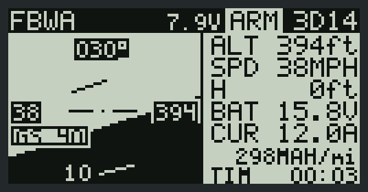 | 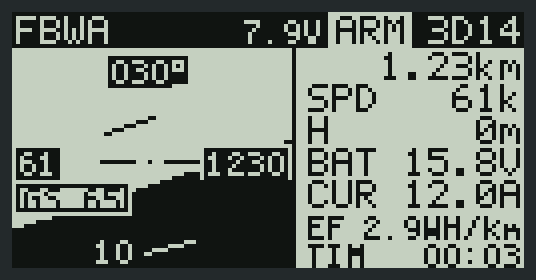 |

| Alt/Dist setting | Altitude | Distance | Efficiency |
|---|---|---|---|
| Metric | `120m` · `1.23km` | `850m` · `1.5k` | `WH/km` · `MAH/km` |
| Feet/Miles | `394ft` | `528ft` · `0.9mi` | `WH/mi` · `MAH/mi` |

Speed has its own setting: `k` (km/h), `MS`, `KT` or `MPH`. The flight summary and the map use the same units as the main page.

## Pages

**ENTER** steps through them in this order. Messages appear only with ArduPilot. Flight stats and Sensor check are hidden until you turn them on in Setup.

| | |
|---|---|
| 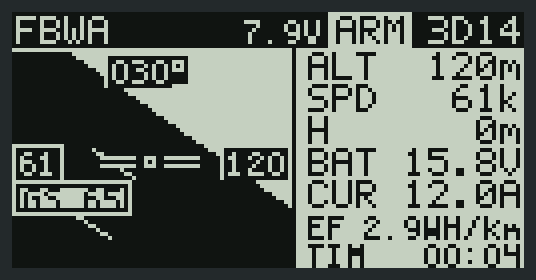 **Main**, banked. | 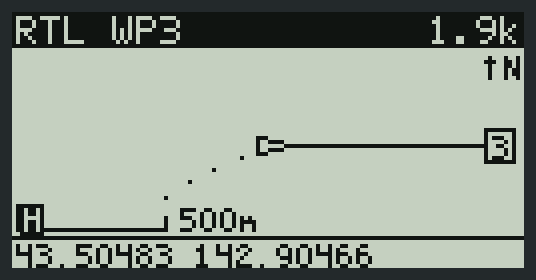 **Map.** North-up vector map with home, the aircraft, its trail, the active waypoint and the coordinates. See [Map](#map). |
| 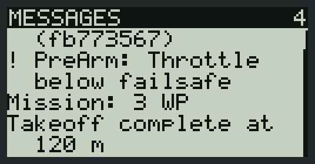 **Messages.** ArduPilot status texts, newest at the bottom, warnings marked `!`. The wheel scrolls back. | 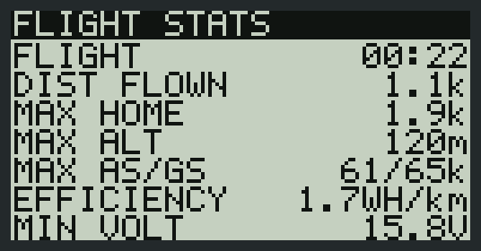 **Flight stats** (optional). The flight in progress, the same rows as the summary. |
| 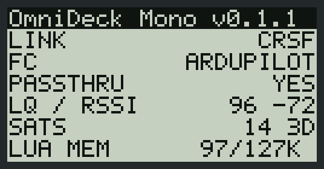 **Link check.** Link, flight controller, passthrough, LQ and RSSI, satellites and the Lua memory in use. | 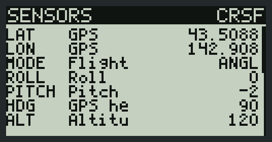 **Sensor check** (optional). Each radio sensor OmniDeck reads and its raw value (INAV over CRSF shown). |

## Map

Setup **MAP VIEW** picks what stays in the centre, as on the colour builds:

| Aircraft-centred (default) | Home-centred |
|---|---|
|  | 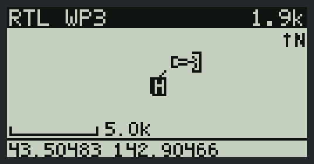 |
| The aircraft stays in the middle. The **wheel** (or **+** / **−**) zooms: right closer, left further out, through range steps from 50 m to 50 km from the centre to the nearest edge. It starts at 300 m and keeps its zoom when you change pages. | Home stays in the middle and the map zooms itself: out at once when the aircraft nears the edge, back in one step at a time (at most every 2 s) once it is well inside, and to the closest step again each time you arm. |

- **Home** is a boxed `H`. When it is off the map it stays at the edge, so it shows the way home.
- **Trail** dots, the **active waypoint** (ArduPilot sends only that one) with a dotted line to it, a **scale bar** at the bottom left and **N** at the top right.
- **Coordinates** along the bottom: the aircraft's latitude and longitude to 5 decimals (about 1 m; the radio's Lua numbers are 32-bit). With no GPS fix the last known position shows, marked `LAST`, to help find a plane that is down out of sight.
- **Top bar:** flight mode, the active waypoint, and the distance to home.

## Flight summary and log

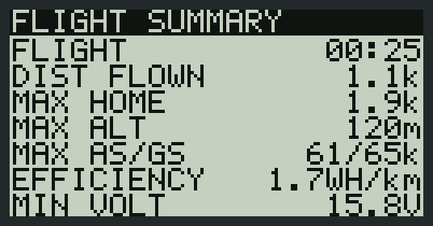

The **flight summary** opens by itself at disarm when the aircraft was armed for at least 10 seconds: flight time, distance flown (the whole track), furthest from home, max altitude, max airspeed and ground speed, efficiency and the lowest voltage. It goes back to the start page by itself after 15 seconds; **ENTER** goes back sooner.

With **FLIGHT LOG** on in Setup, the same flights are also written as text files to `SCRIPTS/OMNID/logs/`. Set the radio's clock, or the file names and dates will be wrong.

## Voice and alarms

The same call-outs as the colour builds, from the packs in `SCRIPTS/OMNID/audio/` (Aria and Guy are included): flight modes, arm and disarm, battery percent while armed (50, 40, 30, 25, 20, 15, 10 and 5 %), failsafes, GPS fix changes, telemetry lost and recovered, ready and not ready to arm, ArduPilot messages worth hearing such as "Takeoff complete", a beep for other messages, and the low and critical voltage per cell when set in Setup. "OmniDeck telemetry ready" plays when the radio starts or you select the model.

## Settings

**SYS › Tools › OmniDeck Setup**, saved per model in `SCRIPTS/OMNID/<model>.cfg`. EdgeTX pauses telemetry scripts while a tool runs, so a change takes effect when you leave.

| Setup | Editing a value |
|---|---|
| 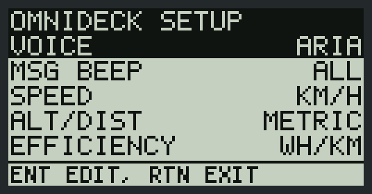 | 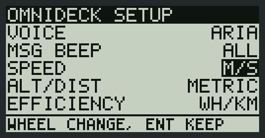 |

| Setting | Choices | Default |
|---|---|---|
| VOICE | a voice pack, or Off | first pack found |
| MSG BEEP | All, Warnings, Off | All |
| SPEED | km/h, m/s, knots, mph | km/h |
| ALT/DIST | Metric, Feet/Miles | Metric |
| EFFICIENCY | Wh/km, mAh/km, Wh/mi, mAh/mi | Wh/km |
| SUMMARY | On disarm, Off | On disarm |
| FLIGHT LOG | Off, On (text file in `OMNID/logs`) | Off |
| CELLS | 0 to 14; 0 = auto | 0 |
| LOW V/CELL | 0 to 4.50 V in 0.05 V steps; 0 = off | Off |
| CRIT V/CELL | 0 to 4.50 V in 0.05 V steps; 0 = off | Off |
| BATT MAH | pack capacity for INAV and Betaflight, which don't send it; 0 = off | 0 |
| START PAGE | Main, Map | Main |
| MAP VIEW | Aircraft, Home: what the map keeps in the centre | Aircraft |
| STATS PAGE | Hide, Show | Hide |
| SENSOR PAGE | Hide, Show | Hide |
| LINK | Auto, CRSF, S.Port | Auto |

## ArduPilot parameters

OmniDeck Mono has no parameter editor of its own. To read and change ArduPilot parameters from the radio, install the [AP Param Editor](https://github.com/erwinquilloy/ap-param-editor) and open it from **SYS › Tools › APParam**. It runs on black-and-white and colour EdgeTX radios and on Ethos.

| Link | AP Param Editor needs |
|---|---|
| S.Port, F.Port | ArduPilot with FrSky passthrough telemetry |
| ExpressLRS, TBS Crossfire | ArduPlane Stratos v2.2.1 or later on the flight controller |
| mLRS | **Tx Ser Port = cbridge** on the mLRS transmitter; any ArduPilot |

While it runs, EdgeTX pauses the OmniDeck screen. While armed the editor is view only: turn on **AIR EDITS** in its tab list to save any parameter while armed (a change takes effect at once, so use small steps). AIR EDITS is OFF again every time the editor opens.

## Memory

A TX12 MK2 gives Lua scripts about **127 KB**. EdgeTX stops every Lua script with "Lua disabled!" once that is used up, and its count includes garbage not yet collected. OmniDeck Mono loads one page at a time, clears the garbage once it is 8 KB above the live data, and never lets the total pass 112 KB.

| Measured on a TX12 MK2 | Lua memory |
|---|---|
| Telemetry script, ArduPilot or INAV, flying pages | about 97 of 127 KB |
| At disarm with the flight log on | 101 of 127 KB |
| Over mLRS, which sends bigger telemetry frames | 107 of 127 KB |

The Link check page shows the live figure, garbage included.

## Problems

- **"not enough memory" when the script starts:** a `telem.lua` source file is on the card. Delete it and keep `telem.luac`.
- **No telemetry on INAV or Betaflight:** discover the sensors again on the radio with the aircraft powered.
- **Horizon stays level on INAV over S.Port or F.Port:** turn on **Use Pitch & Roll sensors in telemetry** in INAV.
- **Flight time 00:00 on ArduPilot on the bench:** expected; it counts only while ArduPilot reports it is flying.
- **No flight summary:** the aircraft has to be armed for at least 10 seconds, and SUMMARY must be On disarm.
- **Setup changes don't show:** leave the tool with **RTN**; settings apply when the telemetry screen starts again.
- **Log file dates are wrong:** set the radio's clock.
- **mLRS Configurator stays on "parameters loading":** the model has a second module set to CRSF. Set the RF section that is not mLRS to OFF.
- **ExpressLRS script stays on "External TX…":** the model's internal module is not set to CRSF. Set Internal RF to CRSF and External RF to OFF.

Report anything else on the [Arduplane Stratos Discord](https://discord.gg/NrfaPSpEFp) with the radio and EdgeTX version, the flight controller and firmware, the link, and a photo of the Link check or Sensor check page.

## Test status

| Test | Result |
|---|---|
| ArduPilot on TX12 MK2, EdgeTX 2.12: all pages, voice, summary | Bench pass |
| INAV over ExpressLRS: arm and disarm cycles, flight log | Bench pass |
| mLRS 1.4.04 on TX12 MK2: all pages, arming | Bench pass |
| Freeze after leaving OmniDeck while armed, over mLRS | Seen once; memory margin raised, retest pending |
| Flight test | Not yet |
| Pocket and Boxer | Not yet |

## Compared with colour OmniDeck

- No map tiles. The map shows only the active waypoint, because ArduPilot's passthrough sends only that one. No mission files or INAV mission download.
- No touch, speed tapes or side panel: the screen is 128 × 64.
- No built-in parameter editor; use the AP Param Editor.

Screens on this page are rendered by the OmniDeck Mono simulator from the release code; memory figures come from a RadioMaster TX12 MK2 on EdgeTX 2.12.

## Licence

OmniDeck Mono is part of OmniDeck, free software under the [GNU General Public License v3.0](../../LICENSE).

## Support

OmniDeck is free. If it helps you fly, a coffee keeps it going: PayPal [$10](https://paypal.me/iamwinq/10USD) · [any amount](https://paypal.me/iamwinq), or [Ko-fi](https://ko-fi.com/windfpv).
